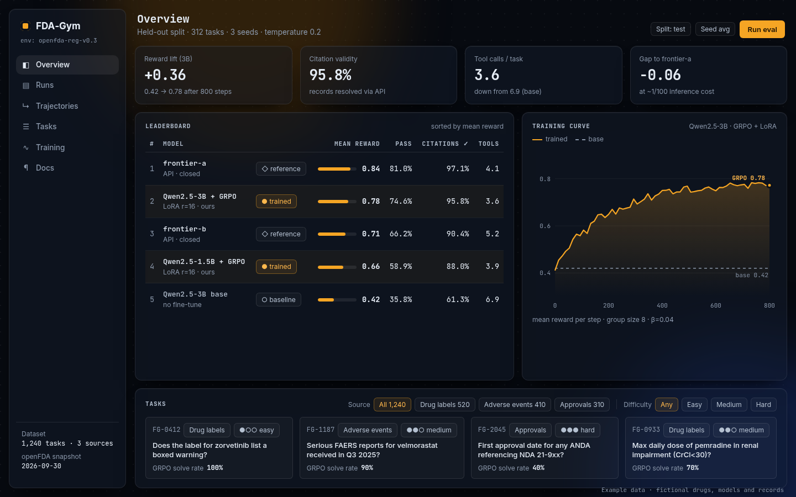

# FDA-Gym

A tool-use RL environment over a frozen [openFDA](https://open.fda.gov/) snapshot. An agent answers a regulatory question by calling tools, then `submit_answer`. The grader scores the answer and the trace. A memorized fact with a fake citation does not pay.

The published sheet is 93 questions, `FG-9101`–`FG-9193`, in [`data/tasks/public.jsonl`](data/tasks/public.jsonl). Freeze: `2026-10-15` (`drug/label`, `drug/event`, `drug/drugsfda`).



## Quickstart (offline, no GPU, no API keys)

Python 3.11+ and [uv](https://docs.astral.sh/uv/).

```bash
uv sync --group dev
uv run python scripts/demo_public_episode.py
uv run pytest -q
```

That smoke run uses the committed snapshot. It never calls live openFDA or an LLM.

The demo replays one published task (`FG-9101`, a 3-call FAERS compare) through `FDAEnv` on freeze `2026-10-15`. After every hop it prints the tool, a truncated observation, and the grader breakdown (`correctness` / `citation` / `format` / `efficiency` / `total` / `grader_version`). Partial scores before `submit_answer` stay at 0. The honest oracle should end at total 1.0. Override the row with `--task-id FG-9101`–`FG-9193`. No GPU, no `OPENROUTER_API_KEY`. This is one episode, not a 93-row model eval.

Score a Chat Completions model on the published sheet. Put `OPENROUTER_API_KEY` in `.env`:

```bash
cp .env.example .env
uv run python scripts/eval_chat.py --model openrouter/qwen/qwen-2.5-7b-instruct --split public --run-id public-eval
```

`--split` is any `*.jsonl` stem in `data/tasks/` (`public`, `hard_train`, `hard_train_holdout`, `train`, `test`). An existing `results/<run-id>` is refused unless you pass `--overwrite`.

Import the installed wheel without a git checkout:

```bash
uv build --wheel
uv venv /tmp/fdagym-wheel && uv pip install --python /tmp/fdagym-wheel/bin/python dist/*.whl
cd /tmp && /tmp/fdagym-wheel/bin/python -c "import fdagym, fdagym.env, fdagym.rewards"
```

The wheel does not ship the 87 MB snapshot. Point at a clone with `FDAGYM_SNAPSHOT_DIR=/path/to/fda-gym/data/snapshots`, or run `python -m fdagym.openfda`. CI's wheel smoke sets that env var from the checkout freeze. It steps the `FG-9101` honest hops from `data/tasks/public.jsonl` and runs `fdagym.rewards.score()` (grader v5) from the installed wheel, not the source tree. Training extras are optional: `uv sync --extra train` (CPU) or `--extra gpu`. CPU dry-run is `uv run python scripts/grpo_singleturn.py --dry-run`. See [docs/train.md](docs/train.md). Pytest, the dashboard, and this README do not need a GPU vendor or Weights & Biases.

## Why a grader this strict

A model that already knows the answer can still fail if it does not retrieve the evidence. A model that guesses one of three drugs can still fail if the comparison is not in the trace.

Total: `0.60 * correctness + 0.25 * citation + 0.10 * format + 0.05 * efficiency`. Every score includes `grader_version`. Current grader: v5.

| Term | Pays when |
| --- | --- |
| format | `submit_answer` matches the schema. Invalid format forces correctness to 0. |
| citation | cited `id` appeared in this trajectory, `field` is in `gold_citations`, quote fuzzy-matches ≥ 0.9. Quotes < 4 characters never count. |
| correctness | format is 1, at least one citation is valid, the answer matches gold, and the hop / compare proof is in the trace. |
| efficiency | only when correctness > 0. Distinct `(tool, arguments)` pairs. Repeated identical calls are free. |

`compare` pays correctness only when every named drug was queried (so unique/none is visible) and a valid citation is about the deciding drug. `sponsor_hop` already needed that kind of proof. One tool call and a short quote from `results` is not enough.

### Shortcuts the v5 suite catches

From `tests/rewards/test_public_attacks.py` and `tests/rewards/test_compare_proof.py` (grader v5, committed `2026-10-15` freeze):

| Attack | Score |
| --- | --- |
| Honest oracle (every `oracle_call`, gold answer, gold citations) | 93 / 93 pass |
| One-call compare guess (first `oracle_call` + generic quote + gold or first-named drug) | 0 / 50 |
| One-call sponsor-hop (same attack on `sponsor_hop`) | 0 / 43 |
| Quitter (`unknown`, no citations) | 0 / 93 |
| FG-9101: one FAERS call on abacavir, quote `"PAIN"`, answer `"pravastatin"` | correctness 0 (citation can still be 1) |

## Committed baselines

The table below is from a committed file under `results/`, labeled with the grader it was scored under.

### OpenRouter public.jsonl

`results/public-haiku-luna-2026-11-05.jsonl`, split `public`, 93 tasks `FG-9101`–`FG-9193`, 50 compare + 43 sponsor_hop, seed 1. Grader v5, snapshot `2026-10-15`. `TOOL_BUDGET` 8 with the then-current hard cut: 8 non-submit tools, then `submit_answer` is still accepted; a 9th search/get ends as `max_steps`. Started `2026-11-06T03:34:55Z` (9:35 PM America/Mexico_City on Nov 5). Wall ~24 min. Cost cap $1; real cost $0.267374. `summary.status` is `incomplete` only because `failure_count=9`; all 186 trajectories exist and count in n=93. See `results/public-haiku-luna-2026-11-05/summary.json`.

| Model | n | mean reward (v5) | pass | mean citation | mean tools | cost_usd |
| --- | --- | --- | --- | --- | --- | --- |
| `openrouter/openai/gpt-6-luna` | 93 | 0.5817 | 45/93 (48.39%) | 0.698 | 5.1183 | 0.055976 |
| `openrouter/anthropic/claude-haiku-5.5` | 93 | 0.4795 | 39/93 (41.94%) | 0.4799 | 5.3656 | 0.211398 |

Pass = correctness > 0.

| Type | n | Luna mean / pass | Haiku 5.5 mean / pass |
| --- | --- | --- | --- |
| compare | 50 | 0.7314 / 36/50 (72%) | 0.6047 / 31/50 (62%) |
| sponsor_hop | 43 | 0.4077 / 9/43 (21%) | 0.3340 / 8/43 (19%) |

Nine `error` rows: the model called `submit_answer` but it failed the schema (`submit_answer is missing or does not match the schema`). These are not absent submits. IDs: Luna `FG-9185`; Haiku `FG-9110`, `FG-9155`, `FG-9164`, `FG-9177`, `FG-9185`, `FG-9186`, `FG-9187`, `FG-9189` (`failures.jsonl`). Three `max_steps` (also total 0): Luna `FG-9118`, `FG-9140`; Haiku `FG-9152`. Each had 8 successful tools plus a rejected 9th (`search_drug_label` / `get_label_section` / `search_approvals`) with `tool budget exhausted; call submit_answer`.

## Tools

The model does not send a raw search string. Each call takes a drug name, a section, a year, an application number, or a sponsor name.

| Tool | What it returns |
| --- | --- |
| `search_drug_label` | Label summaries for one generic name. `has_section` keeps labels that contain that section. |
| `get_label_section` | One section of a label that `search_drug_label` already returned in this episode. |
| `query_adverse_events` | FAERS reports for one generic name. `top_reactions` lists MedDRA terms. `count` returns how many reports match. |
| `search_approvals` | Drugs@FDA records. Pass exactly one of `generic_name`, `application_number`, or `sponsor_name`. |
| `submit_answer` | Ends the episode. The answer is one string, number, or boolean, or `NOT_FOUND`, plus up to 8 citations. |

`FDAEnv` is a tool-use environment, not a Gymnasium env. `reset(task_id)` returns `{question, tools}`. `step(action, latency_ms=...)` returns `(observation, reward, done, info)`. Reward stays 0.0 until the episode ends. `tool_budget` (default 8) is the advertised soft target. Non-submit tools are hard-capped at 2× `tool_budget` (default 16 when budget is 8); `submit_answer` is still accepted after that. Invalid JSON is logged as `invalid_action`.

## Splits

| File | n | Role |
| --- | --- | --- |
| [`data/tasks/public.jsonl`](data/tasks/public.jsonl) | 93 | Published eval (`FG-9101`–`FG-9193`). Leaderboard sheet. |
| [`data/tasks/hard_train.jsonl`](data/tasks/hard_train.jsonl) | 334 | Hard-style training pool (`FG-8101`+). |
| [`data/tasks/hard_train_holdout.jsonl`](data/tasks/hard_train_holdout.jsonl) | 36 | In-distribution question holdout (~10% of the generated pool). Same drugs as `hard_train`. Never mixed into training. |
| [`data/tasks/train.jsonl`](data/tasks/train.jsonl) / [`test.jsonl`](data/tasks/test.jsonl) | 1229 / 342 | Original type mix (boxed warning, FAERS, approvals). |

`hard_train` and `hard_train_holdout` share no drugs, application numbers, sponsors, or question text with `public.jsonl`. A training drug that owns an eval application number is an overlap. They also share none of those with `test.jsonl`. The holdout may share drugs with `hard_train`.

openFDA records are United States government work. See [openFDA terms of service](https://open.fda.gov/terms/). Names, application numbers, and label text in the snapshot and in the task files come from that source. Code is MIT.

`OPENFDA_API_KEY` is only for recording a new snapshot. The tests do not need a key. Verify stored bodies with `python -m fdagym.openfda verify`.

## Dashboard

```bash
cp results/public-eval.jsonl web/public/results/
cd web && npm ci && npm run dev
```

Open [http://localhost:3000](http://localhost:3000). The overview reads the jsonl files in `web/public/results/`. Design reference: [`docs/design/B1-overview.png`](docs/design/B1-overview.png).

## Verifiers / Environments Hub

This repo has a [verifiers](https://github.com/PrimeIntellect-ai/verifiers) wrapper and a Hub package at [`environments/fda-gym/`](environments/fda-gym/). Both expose the five tools above and grade with `fdagym.rewards.score()` (grader v5). The published sheet is [`data/tasks/public.jsonl`](data/tasks/public.jsonl) (`FG-9101`–`FG-9193`, 50 `compare` and 43 `sponsor_hop`). Ids outside that public range are refused. The prompt tells the model it may make 8 tool calls besides `submit_answer`. See [PrimeIntellect-ai/verifiers Discussion #3071](https://github.com/PrimeIntellect-ai/verifiers/discussions/3071).

The `fdagym` library wheel does not ship the freeze. The Hub environment wheel includes `public.jsonl` and `data/snapshots/2026-10-15`, so a git checkout is not required after `prime env install`. Set `FDAGYM_SNAPSHOT_DIR` or `FDAGYM_PUBLIC_JSONL` to override those files.

Run the wrapper from this checkout:

```bash
uv sync --extra prime
uv run vf-eval fdagym --dry-run --no-push
uv run vf-eval @ configs/prime.toml --dry-run --no-push
```

Install the Hub package ([listing](https://app.primeintellect.ai/dashboard/environments/jpzarza/fda-gym)):

```bash
prime env install jpzarza/fda-gym
uv run vf-eval fda-gym --dry-run --no-push
```

The optional extra pins `verifiers==0.4.0`, so the CLI is `vf-eval` (`uv run vf-eval @ configs/prime.toml`). Point `--select.include.ids` at a public id such as `FG-9101` for a one-task run. That is not a 93-row model baseline. `--extra prime` cannot be combined with `--extra hud` or `--extra gpu`. HUD wants mcp>=2.2.0; `verifiers==0.4.0` pins mcp==2.0.0. The env contract remains `FDAEnv.reset` / `FDAEnv.step` above.

## HUD

An optional [HUD](https://docs.hud.ai) SDK Environment wraps the same `FDAEnv`, five tools, and `score()` path. It uses `data/tasks/public.jsonl` only (`FG-9101`–`FG-9193`). No GPU. Default `uv sync --group dev` does not install the SDK. Do not combine `--extra hud` with `--extra gpu`. Use `--extra hud` on its own or with `--extra train`. `--extra hud` cannot be combined with `--extra prime`. HUD wants mcp>=2.2.0; `verifiers==0.4.0` pins mcp==2.0.0.

```bash
uv sync --extra hud
uv run hud eval tasks.py claude
uv run hud eval tasks.py claude --all
```

`hud eval` spawns the env locally, with no Docker. The first command runs one public task. `--all` runs FG-9101–FG-9193. Use `claude`, another catalog model, or `--model …`. That run needs a provider key or `HUD_API_KEY` for the model. Tests do not. Cap agent steps with `--max-steps` if you override the per-task default (16 tools plus `submit_answer`, 17). Snapshot discovery matches the keyless demo: `FDAGYM_SNAPSHOT_DIR` or a checkout's `data/snapshots` freeze `2026-10-15`.

`Dockerfile.hud` is optional and deploy-only (`hud deploy` / `hud serve` in an image). Local `hud eval` does not use it. The wheel does not ship the 87 MB snapshot.

## Tests and CI

Default extra-free CI (`uv sync --frozen --group dev`) runs ruff, format, pyright, pytest, and the wheel smoke. Pytest builds the Hub package at `environments/fda-gym` and checks that `public.jsonl` and freeze `2026-10-15` resolve. Separate jobs install `--extra prime` and `--extra hud` on their own. They cannot be combined. Prime runs the SDK tests plus `vf-eval --dry-run --no-push` for `fdagym` and `fda-gym`. HUD runs the SDK tests. Neither job runs a paid or model-backed `hud eval`. No job uses `--extra gpu`.

```bash
uv run ruff check .
uv run ruff format --check .
uv run pyright
uv run pytest -q
cd web && npm ci && npm run lint && npm run build
```

MIT license. See [LICENSE](LICENSE).
