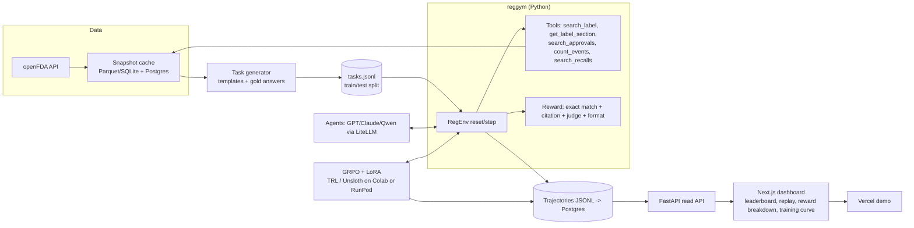

# Plan técnico: FDA Regulatory RL Environment (3–4 días)

> Proyecto open source de portafolio de JP Zarza. Objetivo: un **Gym-style RL environment** donde un agente LLM usa **tools** sobre datos públicos de **openFDA** para responder preguntas regulatorias, con **rewards verificables automáticamente**, baseline evals, un fine-tune **GRPO + LoRA** y un dashboard Next.js muy pulido.

## 1. Nombres posibles
- **RegGym**: corto, claro ("Gym" + regulatorio)
- **openFDA-Gym**: SEO directo
- **LabelBench**: suena a benchmark
- **Pharmacopeia Arena**: más "producto"
- **Orange Book RL**: guiño al Orange Book de la FDA

Recomendado: **RegGym** (repo `reggym`).

## 2. Endpoints openFDA (base `https://api.fda.gov`)
| Endpoint | Uso en tasks |
|---|---|
| `/drug/label.json` | Etiquetas SPL: `boxed_warning`, `indications_and_usage`, `contraindications`, `set_id` |
| `/drug/drugsfda.json` | Aplicaciones NDA/ANDA/BLA, `submissions` con fechas de aprobación, `sponsor_name` |
| `/drug/event.json` | FAERS (eventos adversos), soporta `count=` para agregados |
| `/drug/enforcement.json` | Recalls (`classification`, `recall_number`) |
| `/drug/ndc.json` | Directorio NDC (`product_ndc`, `dosage_form`) |

Notas: sin API key 240 req/min y 1,000/día por IP; con key gratuita 120,000/día (verificar en open.fda.gov/apis/authentication). **Snapshot** de respuestas en disco (cache por query) para que el reward sea **determinista** y reproducible aunque openFDA se actualice.

## 3. Arquitectura

Para el demo hosteado: exportar resultados a JSON estáticos y servirlos desde Next (sin backend en Vercel). FastAPI + Postgres queda para correr local con `docker compose up`.

## 4. Estructura del repo
```
reggym/
  reggym/                # paquete Python (pip install -e .)
    env.py               # RegEnv: reset(task_id) -> obs, step(action) -> obs, reward, done, info
    tools/               # openfda client + tools (JSON schema para function calling)
    cache/               # snapshot loader
    rewards/             # exact.py, citation.py, judge.py, format.py, combine.py
    tasks/               # templates + generator + validators
    agents/              # runner LiteLLM (multi-turn tool loop, max_steps=6)
  data/tasks/{train,test}.jsonl
  data/snapshots/        # respuestas cacheadas (git-lfs o release asset)
  evals/run_baseline.py  # -> results/*.jsonl
  training/
    grpo_singleturn.py   # TRL GRPOTrainer + LoRA (plan A)
    grpo_tools.py        # multi-turn con tools (stretch)
    colab.ipynb
  api/                   # FastAPI (lectura de resultados)
  web/                   # Next.js 15 + Tailwind + shadcn/ui + Framer Motion + Recharts
  docker-compose.yml     # postgres + api + web
  README.md  docs/
```

## 5. Diseño del dataset de tasks
~300 tasks generadas por **templates** a partir del snapshot (gold answer sale del dato, no de un humano): 240 train / 60 test, estratificado por tipo y dificultad. 5 tipos:

| # | Ejemplo | Tools esperadas | Verificación |
|---|---|---|---|
| 1 | "¿En qué año aprobó la FDA originalmente la aplicación NDA de *Ozempic* (semaglutide)?" | `search_approvals` | **Exact match** del año contra `submissions` con `submission_type=ORIG` y status `AP` |
| 2 | "¿La etiqueta de *warfarin* tiene boxed warning? ¿Sobre qué riesgo?" | `search_label`, `get_label_section` | Booleano exacto + **keyword set** ("bleeding") + **citation**: `set_id` + sección `boxed_warning` debe existir y contener el span citado |
| 3 | "Cuál es la reacción adversa más reportada en FAERS para *metformin* como suspect drug?" | `count_events` | Exact match contra top-1 de `count=patient.reaction.reactionmeddrapt.exact` (normalizar MedDRA, mayúsculas) |
| 4 | "¿Cuántos recalls Class I de medicamentos hubo con `report_date` en 2023 que mencionen 'sterility'?" | `search_recalls` | Número exacto (tolerancia 0) desde snapshot; reward parcial si ±10% |
| 5 | "Resume las contraindicaciones de *isotretinoin* para una paciente que planea embarazo." (abierta) | `get_label_section` | **LLM-judge** con rúbrica (3 criterios binarios: menciona embarazo/teratogenicidad, cita sección correcta, no inventa) + citation check. Solo ~10% de tasks; validado con ~20 muestras calificadas por JP |

Formato de respuesta obligatorio (parseable):
```json
{"answer": "...", "citations": [{"endpoint":"drug/label","id":"<set_id>","field":"boxed_warning","quote":"..."}]}
```

## 6. Reward function
```
R = 0.6*correctness + 0.25*citation + 0.1*format + 0.05*efficiency
```
- **correctness** ∈ [0,1]: exact/normalized match, numérico con tolerancia, o judge score (tipo 5).
- **citation** ∈ [0,1]: fracción de citas cuyo `id` existe en el snapshot, cuyo `field` es correcto, y cuyo `quote` es substring (fuzzy ≥0.9) del campo.
- **format**: 1 si el JSON valida contra schema, si no 0 (y correctness=0).
- **efficiency**: 1 − steps/max_steps (solo si correctness>0, para no premiar rendirse rápido).
- Se loggea el **breakdown** por componente en cada trajectory (lo que muestra el dashboard).

### Anti-reward-hacking
- Citation quote debe venir de un **tool output real de esa trajectory** (no solo existir en el snapshot): evita citas memorizadas/inventadas.
- Efficiency condicionada a correctness; penalizar respuestas vacías o "no sé" en tasks con respuesta.
- Respuestas tipo lista "A o B o C" → match solo si la respuesta normalizada es un único valor.
- Judge: rúbrica binaria, temperatura 0, modelo distinto al evaluado, nunca ve el gold de forma que se pueda filtrar; auditar 20 muestras.
- Test split con **drogas no vistas** en train (split por entidad, no por task) para medir generalización y no memorización.
- Revisar manualmente las 20 trajectories de mayor reward tras el training.

## 7. GRPO + LoRA (realista)
- **TRL `GRPOTrainer`** soporta LoRA vía `peft_config` y reward functions custom (lista de funciones, se suman). **Unsloth** tiene notebooks GRPO para Qwen2.5 en Colab con 4-bit + vLLM. Soporte de multi-turn con tools en TRL existe pero es reciente/experimental (verificar versión al arrancar; docs "GRPO Trainer" de TRL).
- **Plan A (pragmático, seguro):** *single-turn with pre-fetched context*. Para cada task se ejecuta offline la secuencia de tools "oráculo" + distractores (2–3 documentos, uno irrelevante) y se mete en el prompt; el modelo debe elegir, responder y citar en el JSON. Mismo reward (correctness + citation + format). Entrena *grounded answering + citation*, que es lo que más mejora en modelos chicos.
- **Plan B (stretch):** multi-turn con tools limitadas (max 3 steps) usando el soporte de tools de TRL o un rollout loop propio con vLLM; solo si Plan A corre el día 2.
- Modelo: **Qwen2.5-1.5B-Instruct** (Colab T4 gratis) o **Qwen2.5-3B-Instruct** (A10/L4/A100).
- Hiperparámetros iniciales: LoRA r=16, α=32, lr 5e-6–1e-5, `num_generations`=6–8, max_completion 256, ~300–500 steps.
- **Compute (estimaciones):** 1.5B en T4 gratis con Unsloth 4-bit: ~2–4 h para ~300 steps (riesgo de desconexión de Colab). 3B en RunPod/Lambda A100 40GB (~$1.2–2/h): ~2–3 h → **~$5–15** total. Baselines con APIs (60 tasks × 3 modelos × ~6 steps): **~$5–20**. Presupuesto total estimado: **<$50**.
- Entregable: gráfica **reward before vs after** en test split (y por componente), más curva de reward en training.

## 8. Plan por día (workstreams paralelos para agentes)
Convención: cada agente trabaja en su branch, con un **contrato compartido** definido en hora 1: `schemas/trajectory.schema.json`, `schemas/task.schema.json`. JP revisa/mergea PRs.

### Día 1: Environment + datos
- **A1 Data/snapshot:** "Implementa `reggym/tools/openfda.py`: cliente con rate limiting, retries y cache en disco por hash de query para `/drug/label`, `/drug/drugsfda`, `/drug/event`, `/drug/enforcement`. Script `scripts/snapshot.py` que baja datos para una lista de 150 drogas (top prescripciones). Tests con respuestas grabadas."
- **A2 Tasks:** "Implementa generador de tasks por templates (5 tipos de la sección 5) a partir del snapshot, con gold answer y metadata (`type`, `difficulty`, `entity`). Split por entidad 80/20. Valida que cada gold sea no vacío y único. Output `data/tasks/*.jsonl` según `task.schema.json`."
- **A3 Env + rewards:** "Implementa `RegEnv` (reset/step, max_steps=6), tools con JSON schema estilo OpenAI function calling, y `rewards/` con breakdown según la sección 6, incluyendo las reglas anti-hacking. 100% de tests en reward functions con casos adversariales."
- **A4 Design (en paralelo):** "Diseña en Figma/v0 el dashboard: leaderboard, trajectory replay (timeline de steps: thought → tool call → output → answer), panel de reward breakdown, vista de training. Estética editorial/clínica, dark mode, tipografía monoespaciada para tool I/O."
- **DoD día 1:** `python -m reggym.demo` corre una task end-to-end con un modelo API.

### Día 2: Baselines + training Plan A
- **A1 Evals:** "Runner con LiteLLM: corre test split con GPT-4o-mini, Claude Haiku y Qwen2.5-1.5B (vLLM/Ollama). Guarda trajectories JSONL según schema, con costo y latencia. Reporte agregado por tipo de task."
- **A2 Training:** "Notebook Colab + script `grpo_singleturn.py` con TRL GRPOTrainer (o Unsloth), LoRA, reward functions importadas de `reggym.rewards`. Prompts con contexto pre-fetched + distractores. Loggea a W&B. Evalúa checkpoint en test."
- **A3 Web scaffold:** "Next.js 15 + Tailwind + shadcn: leaderboard leyendo `public/results/*.json`, rutas `/runs/[id]` con replay paso a paso (teclas ←/→, autoplay), Framer Motion en transiciones."
- **DoD día 2:** baselines publicados en JSON; primer run de GRPO con curva de reward subiendo.

### Día 3: Dashboard pulido + training final
- **A3 Web:** reward breakdown (stacked bar por componente), diff "base vs fine-tuned" en la misma task, filtros por tipo/modelo, página `/training` con curva y before/after, empty/loading states, responsive, accesibilidad (focus states, contraste).
- **A2 Training:** run final (3B si hay GPU), eval test, export de métricas; stretch Plan B si sobra tiempo.
- **A1 API/infra:** FastAPI + Postgres + `docker-compose up` que levanta todo localmente; script de export a JSON estático para Vercel.
- **A4 QA/hacking audit:** revisar top-reward trajectories, abrir issues de reward hacking, fixes.

### Día 4: Launch
- README (GIF del replay arriba, quickstart en 3 comandos, tabla de resultados, diseño del reward, limitaciones), `docs/design.md`, licencia MIT, LoRA en Hugging Face Hub, dataset en HF Datasets.
- Deploy Vercel, Loom de 2 min (problema → replay de una trajectory → before/after → cómo agregar tasks).
- Mensajes de aplicación (sección 10).

## 9. Riesgos y fallbacks
| Riesgo | Fallback |
|---|---|
| Rate limits / cambios de openFDA | Snapshot completo día 1; API key gratuita; todo el env corre offline |
| GRPO no sube el reward | Más tasks fáciles (curriculum), subir `num_generations`, bajar lr; si no, SFT con trajectories buenas + GRPO corto, y reportarlo honestamente |
| Colab se desconecta | RunPod A100 por horas (estimado <$15), checkpoints cada 50 steps |
| Multi-turn GRPO muy complejo | Quedarse en Plan A; multi-turn solo en evals con modelos API |
| Gold answers ambiguos | Validadores automáticos + descartar tasks con >1 respuesta válida; auditoría manual de 30 tasks |
| Dashboard se ve genérico | Dedicar todo el día 3 de A3 a diseño; referencias: Linear, Vercel, W&B |
| Agentes rompen contratos entre sí | JSON schemas fijados hora 1 + tests de contrato en CI |

## 10. Definition of Done
- [ ] `pip install -e . && python -m reggym.demo` funciona offline con el snapshot
- [ ] ≥300 tasks (5 tipos), split train/test por entidad, gold verificado automáticamente
- [ ] Reward con breakdown + tests, incluyendo casos de reward hacking
- [ ] Baselines de 3 modelos en el test split publicados
- [ ] LoRA GRPO entrenada con mejora medible en test (o resultado negativo documentado) + gráfica before/after
- [ ] Dashboard en Vercel: leaderboard, replay paso a paso, reward breakdown, training view
- [ ] `docker compose up` levanta Postgres + API + web
- [ ] README con GIF, quickstart, resultados y limitaciones; LoRA y dataset en HF Hub; Loom de 2 min
