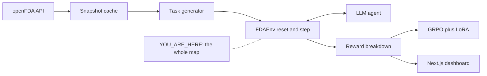

# 00 · Orientation: what FDA-Gym actually is

**Track:** planner · **Branch:** `main` · **Time:** 15 min

**By the end you can:**
- Trace one episode through `reset → step → reward` and say what the agent sees at each point.
- Compute a trajectory's reward by hand and spot a reward-hacking strategy in the formula.
- Explain why GRPO learns nothing from a prompt where every sample gets the same reward.

---

## 2. Where this fits



Every arrow above is a contract between two agents working in parallel. If the reward is wrong, GRPO
will faithfully optimize the wrong thing and the dashboard will show a beautiful, wrong curve.

---

## 3. Concepts

### 3.1 An RL environment for an LLM is just a loop with a scorekeeper

<details>
<summary><b>[predict]</b> In classic RL (a robot, a game), the environment returns a reward after every action. For an agent answering "When was Ozempic first approved?", when should it get its reward, and why?</summary>

Only at the end, when it submits an answer. Intermediate tool calls aren't right or wrong on their own:
searching labels first and approvals second can both lead to the correct answer. This is called a
**sparse, terminal reward**. It's simpler to verify but gives the learner less signal, which matters a lot later (see 3.3).
</details>

The loop: `reset(task_id)` returns the question plus tool schemas (the **observation**). The agent emits
an **action**: either a tool call (`search_approvals(...)`) or `submit_answer({...})`. `step(action)` runs the
tool against the **snapshot** (never the live API, so results are reproducible) and returns the tool output as the next observation.
The episode ends on `submit_answer` or after `max_steps=6`. Everything is logged as a **trajectory**: the replay screen
in [B1-trajectory.png](../docs/design/B1-trajectory.png) is literally one trajectory rendered.

<details>
<summary><b>[recall]</b> Why does `step` read from a disk snapshot instead of calling api.fda.gov?</summary>

Determinism. openFDA updates (its `last_updated` was 2026-07-30 when we checked). If the data shifts mid-training,
the same answer flips from correct to wrong and the reward becomes noise. A frozen snapshot also means no rate limits during training,
where you might run tens of thousands of episodes.
</details>

### 3.2 The reward is a weighted sum, and every weight is an invitation to cheat

Proposed formula (from [PLAN.md §6](../docs/PLAN.md)):

```
R = 0.60 * correctness + 0.25 * citation + 0.10 * format + 0.05 * efficiency
efficiency = 1 - tool_calls / max_steps   (only counted if correctness > 0)
```

<details>
<summary><b>[transfer]</b> A trajectory answers correctly, cites 3 records of which 2 are valid, uses valid JSON, and made 3 tool calls (max 6). What is R?</summary>

correctness 1.0 × 0.60 = 0.600
citation 2/3 × 0.25 = 0.167
format 1.0 × 0.10 = 0.100
efficiency (1 − 3/6) = 0.5 × 0.05 = 0.025
**R ≈ 0.89**
</details>

<details>
<summary><b>[transfer]</b> Now the attack. An agent learns to answer "NAUSEA" for every "most-reported adverse event" question, with zero tool calls and no citations. On metformin (where NAUSEA really is #1) what reward does it get? What does that tell you?</summary>

correctness 1 × 0.60 + citation 0 + format 1 × 0.10 + efficiency (1 − 0/6) × 0.05 = **0.75**.
A pure guess, never touching the data, scores 75% of the max. NAUSEA is #1 for a *lot* of drugs, so this is a real attractor.
Defenses to discuss: make correctness count only when backed by a citation that appeared in *this* trajectory's tool outputs,
and check the test split for how often the top-1 answer is the same across drugs (if it's 40%, the task type is weak).
This is exactly the kind of decision the env/rewards agent will bring to you.
</details>

### 3.3 GRPO: learning by comparing siblings

<details>
<summary><b>[predict]</b> GRPO samples 8 answers to the same question and scores each one. Suppose all 8 get R = 1.0. How much does the model change from this question?</summary>

**Not at all.** GRPO's advantage for each sample is roughly `(R_i − mean(R)) / std(R)` within the group of 8.
If they're all equal, every advantage is 0, so there's no gradient. Same if all 8 score 0.
GRPO only learns from questions where the model *sometimes* succeeds. That's why task difficulty mix (easy, medium, hard)
matters more than raw task count, and why the plan has a curriculum fallback.
</details>

No critic or value network is needed, because the group mean acts as the baseline. **LoRA** keeps it cheap: instead of updating all
3B weights, it trains small rank-16 adapter matrices (~0.5% of the parameters) that sit next to the frozen model.

<details>
<summary><b>[why]</b> The design shows a "base 0.42" dashed line on the training curve. Why is the before/after on the *test* split, with drugs never seen in training, the only number that matters?</summary>

Because the model could memorize "warfarin → bleeding" from the training tasks. Splitting by *entity* (drug), not by task,
means a test score reflects the skill (search, read, cite), not recall of specific drugs. A high train reward with a flat test reward means memorization.
</details>

---

## 4. Experiments (live openFDA, no key needed)

### 4.1 The top adverse event for metformin

```bash
curl -s 'https://api.fda.gov/drug/event.json?search=patient.drug.openfda.generic_name:"metformin"&count=patient.reaction.reactionmeddrapt.exact&limit=3'
```

<details>
<summary><b>[predict]</b> What are the top 3 reactions, and roughly how many reports for #1?</summary>

When we ran it (Oct 15, 2026): NAUSEA 30,164 · DIARRHOEA 28,200 · BLOOD GLUCOSE INCREASED 27,577.
Note the British spelling: MedDRA terms are the vocabulary, so the reward must normalize answers (`diarrhea` vs `DIARRHOEA`).
</details>

### 4.2 Restrict to reports where metformin is the *suspect* drug

Add `+AND+patient.drug.drugcharacterization:1` to the search (1 means "suspect drug").

```bash
curl -s 'https://api.fda.gov/drug/event.json?search=patient.drug.openfda.generic_name:"metformin"+AND+patient.drug.drugcharacterization:1&count=patient.reaction.reactionmeddrapt.exact&limit=3'
```

<details>
<summary><b>[predict]</b> Many metformin reports list it as a background medication, not the suspect. How much should NAUSEA's count drop?</summary>

It barely moves: 30,164 → 30,099. **This is a bug, not a fact about metformin.** A report has a list of drugs, and openFDA does not tie
the two conditions to the *same* list element. The query means "metformin is somewhere on the report AND some drug on the report is a suspect".
Almost every report has a suspect drug, so the filter does nothing. Any task phrased "as suspect drug" would get a wrong gold answer.
The data agent must either drop the "suspect" phrasing or compute it from raw reports in the snapshot.
</details>

### 4.3 Which warfarin label?

```bash
curl -s 'https://api.fda.gov/drug/label.json?search=openfda.generic_name:"warfarin"+AND+_exists_:boxed_warning&limit=1' \
  | python3 -c 'import json,sys;d=json.load(sys.stdin);print(d["meta"]["results"]["total"])'
```

<details>
<summary><b>[predict]</b> How many warfarin labels with a boxed warning exist?</summary>

**74.** Every manufacturer and repackager has its own label (its own `set_id`). So "the warfarin label" is ambiguous.
A citation to any of the 74 should probably count, but the task generator must decide this explicitly and the reward must check
against that set. The first one says "WARNING: BLEEDING RISK", which is what the gold keyword check will look for.
</details>

---

## 5. Break it

No code yet. This one is on paper: in the formula in 3.2, change `efficiency` so it is counted **even when correctness = 0**.

<details>
<summary><b>[predict]</b> What behavior does GRPO now reward on hard questions the model can't solve yet?</summary>

Giving up instantly. Zero tool calls plus a garbage answer earns 0.10 (format) + 0.05 (efficiency) = 0.15, while honestly trying with 5 tool calls
and still failing earns 0.10 + 0.008. Among the 8 siblings, the quitter has the highest reward, so GRPO pushes the model toward quitting.
This is why the plan gates efficiency on correctness. The env agent must have a test for it.
</details>

### 5b. Your follow-up: what *should* happen when the agent throws its hands up?

You asked this at the checkpoint, and it deserves a full pass. Here are the decided rules (see §6):
correctness only counts with a **grounded citation**, meaning the cited record appeared in this trajectory's tool output, in a field the
task accepts. Efficiency only counts when correctness > 0. Now score four agents on a hard question none of them answers correctly:

| Agent | Tool calls | Answer | Citations |
|---|---|---|---|
| Quitter | 0 | "unknown", valid JSON | none |
| Spammer | 6 | wrong | 6 citations to irrelevant records it fetched |
| Honest searcher | 4 | wrong | 1 citation to the *right* record and field, but it misread the value |
| Broken | 3 | not valid JSON | — |

<details>
<summary><b>[predict]</b> Rank the four by reward. Does the honest searcher beat the quitter?</summary>

- Honest searcher: 0 + 0.25 × 1.0 (the citation is grounded and in the right field) + 0.10 = **0.35**
- Quitter: 0 + 0 + 0.10 = **0.10**
- Spammer: the citations are grounded but in fields the task doesn't accept, so citation = 0 → **0.10**
- Broken: format 0, and the plan sets correctness to 0 when the format fails → **0.00**

So yes. **The citation term is what pays for honest effort even when the answer is wrong.** Finding the right evidence earns
partial credit, and among 8 siblings that all miss, the ones that found the evidence get a positive advantage.
You don't need a separate "effort bonus" (which would invite tool spam) or a "no tools" penalty (which would invite pointless calls).
The catch: citation credit must check *relevance* (the field the task accepts), not just existence, or the spammer earns 0.25 too.
</details>

<details>
<summary><b>[transfer]</b> Efficiency was <code>1 − calls/6</code>. A hard question that genuinely needs 4 calls can then never earn more than 0.33 efficiency, while an easy one earns 0.83. Is that fair, and what would you change?</summary>

It's unfair: it punishes the task, not the agent. Decided instead: `efficiency = min(1, min_tool_calls / calls)`, where each task records the minimum number of calls an
oracle needs (`difficulty_features.min_tool_calls`). Doing it in the minimum earns 1.0 on any difficulty. This only works because the
task generator records that number, which is one reason the difficulty rubric is structured (see [docs/difficulty.md](../docs/difficulty.md)).
</details>

<details>
<summary><b>[why]</b> Should "I couldn't find it" ever be a <i>correct</i> answer?</summary>

Only when it's true. Real regulatory work rewards saying "openFDA has no record" over guessing. The schema supports
**unanswerable tasks** (`answerable: false`, for example a drug with no FAERS reports in the requested window). There, abstaining is the correct answer, but only if the
agent actually searched (a grounded "empty result" citation). On answerable tasks, abstaining scores 0 correctness. You decided: about 5% of tasks, in both splits.
</details>

---

## 6. Decisions made so far

| Decision | Chosen | Instead of |
|---|---|---|
| Data sources | Labels, FAERS adverse events, Drugs@FDA approvals | Also recalls and NDC (cut for scope; matches the design) |
| Name | FDA-Gym, Python package `fdagym` | RegGym |
| Visual direction | B1: dark glass, signal amber `#F5A524` | Teal B, violet B2, lime B3, light C |
| Parallelism | One git worktree and branch per track; JP merges | Shared folder, cloud agents |
| Training GPU | Fly.io GPU machine, paid by the hour | Colab, RunPod |
| Model access | OpenRouter (one key for GPT, Claude, Qwen) + free openFDA key | Separate provider keys |
| Correctness | Counts only with a grounded, relevant citation (JP's call at checkpoint) | Trusting a bare answer |
| Efficiency | `min(1, min_tool_calls / calls)`, only if correct | `1 − calls/6`, which punishes hard tasks |
| Difficulty | Structural rubric, then calibrated by base-model pass rate, then a curriculum ([docs/difficulty.md](../docs/difficulty.md)) | Gut-feel labels |

<details>
<summary><b>[why]</b> Why do the JSON schemas for tasks and trajectories get written <i>before</i> any agent starts coding?</summary>

Four agents build in parallel against each other's outputs: the task generator writes what the env reads, the env writes what the dashboard renders.
If each invents its own shape, merging means rewriting. A schema fixed in hour 1, with a contract test in CI, makes every handoff checkable.
</details>

---

## 7. Gotchas already found

- **Correlated filters on list fields don't work** in openFDA search (experiment 4.2). This affects any "suspect drug" task.
- **One drug has many labels** (74 for warfarin). Gold citations have to accept a set of `set_id`s.
- **MedDRA spelling** is British and uppercase. The answer normalizer needs a synonym map, at least for US/UK spellings.
- **The mockup and the plan disagree** on the reward. The design shows a negative "tool budget" term, while the plan has a gated positive efficiency term. We are going with the plan, and the dashboard will show the plan's components.
- **`+AND+` only works when typed straight into a URL.** The openFDA docs write searches like `a+AND+b`. Pass that through an HTTP client and the `+` gets encoded as a literal plus sign, and openFDA answers 500. With spaces (`a AND b`) the same query returns 18,629 serious metformin reports for 2025. Encoded in a test in `tests/test_queries.py`.
- **Half of Drugs@FDA is invisible to a generic-name search.** Many application records lack the `openfda` block. Searching `openfda.generic_name:"semaglutide"` finds 1 application, while `products.active_ingredients.name:"semaglutide"` finds 6, including Ozempic's original NDA209637. For warfarin it's 5 versus 21. The plan's flagship question ("when was Ozempic first approved?") would have had a wrong gold answer. The env agent caught this from its fixtures.
- **"No FAERS reports" usually means "not harmonized".** The tasks track generated 5 unanswerable tasks for finerenone, mavacamten and vericiguat, because searching by generic name found nothing. Searching the reported active substance finds 2,960 finerenone reports and 5,080 for mavacamten. openFDA only fills in `openfda.generic_name` for drugs it has mapped, and newer drugs often aren't. Those tasks would have trained the model to answer "NOT_FOUND" for new drugs, a confidently wrong behavior. FAERS queries now OR both fields. Even the top-reaction answer depends on the choice: metformin is NAUSEA by generic name and DIARRHOEA by active substance.
- **The first 100 labels aren't all the labels.** Metformin has 365. The label query now asks for openFDA's maximum of 1,000 per request, which returns 47 MB untrimmed for metformin. So the data track must trim each record down to the fields we use.
- **A frozen snapshot can't answer arbitrary queries.** The agent picks tool arguments, and the snapshot only knows what was recorded. So tools take constrained arguments (drug, year, serious) that map to the finite list in `fdagym/queries.py`, and the snapshot records exactly that list for each drug.
- **Citation-gating makes early training sparse.** A base model that answers correctly but formats its citation badly gets 0. That's the behavior we want, but early on it can mean many groups where all 8 samples score 0. The mitigations are easy tasks first, a worked citation example in the prompt, and dropping 0/8 tasks from each stage's pool.

---

## 8. Checkpoint

1. Run `python3 scripts/quiz.py learn/00-orientation.md`.
2. Then answer these to me in chat:
   - **a.** Propose one concrete rule that kills the "always answer NAUSEA" attack without hurting an honest agent. What does it cost?
   - **b.** The design's KPI says "Citation validity 95.8%". Given experiment 4.3, write the exact rule for when a citation counts as valid.
   - **c.** If after training the test reward goes 0.42 → 0.78 but tool calls per task go 6.9 → 1.2, what's the first thing you'd check in the replays?

I'll read `learn/answers/00-orientation.jsonl`, go through anything you marked partly or no, and then we kick off Day 1.

---

## 9. Read next

- [TRL GRPO Trainer docs](https://huggingface.co/docs/trl/main/en/grpo_trainer): the "advantage" and "reward functions" sections, 10 min. This is what our training code will call.
- [openFDA drug/event searchable fields](https://open.fda.gov/apis/drug/event/searchable-fields/): skim it to see which fields are lists, the source of gotcha #1.
- [PLAN.md §5–6](../docs/PLAN.md): the 5 task types and the anti-hacking rules, now that you can read them critically.
