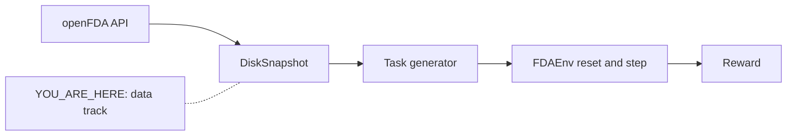

# 01 · Data: a frozen openFDA

**Track:** data · **Branch:** `track/data` · **Time:** 15 min

**By the end you can:**
- Hash a query the same way `DiskSnapshot` does, and name the one argument that orphans every file on disk.
- Tell a `SnapshotMiss` from an empty result, and say which one an unanswerable task is allowed to cite.
- Read `meta.results.total` against `len(results)` and catch a truncated approval page.

---

## 2. Where this fits



The task generator and the env never call api.fda.gov. They call `Snapshot.get`. If this layer records the wrong page, or drops a field a citation has to quote, every gold answer downstream is wrong and the reward will train on it.

---

## 3. Concepts

### 3.1 The snapshot only answers queries we listed ahead of time

<details>
<summary><b>[predict]</b> The agent wants "warfarin labels that mention bleeding". Can the frozen snapshot answer that string?</summary>

No. Tools take a drug, a year, and a seriousness flag. [queries.py](../fdagym/queries.py#L64) turns those into 30 queries per drug, and the recorder fetches exactly that list. Any other search raises `SnapshotMiss` in [store.py](../fdagym/openfda/store.py#L72). There is no live fallback.
</details>

The cache key is the SHA-256 of one compact JSON list: endpoint, search, count, limit, skip. Same list, same file. A space in the JSON, or a different `limit`, is a different file.

```31:33:fdagym/openfda/store.py
def query_key(endpoint: Endpoint, search: str | None, count: str | None, limit: int, skip: int = 0) -> str:
    canonical = json.dumps([endpoint, search, count, limit, skip], separators=(",", ":"))
    return hashlib.sha256(canonical.encode()).hexdigest()
```

`all_queries` is 1 label search, 1 approvals search, and 28 FAERS queries: two builders, seriousness in `{None, True}`, year in `{None, 2020, 2021, 2022, 2023, 2024, 2025}`.

<details>
<summary><b>[recall]</b> LABEL_LIMIT moves from 1000 to 100. The gzip files are still on disk. What does the next offline get of a label return?</summary>

`SnapshotMiss`. `limit` is inside the hash, so the old files are invisible to the new query. That is deliberate. It is also why changing `APPROVALS_LIMIT` later means a new recording, not a rewrite of these files.
</details>

### 3.2 A 404 is a result. A miss is a bug.

<details>
<summary><b>[predict]</b> Xanomeline has no FAERS reports in 2020. Should the client raise, or return JSON?</summary>

Return JSON with `total: 0` and `results: []`. openFDA answers that case as HTTP 404 with `error.code == NOT_FOUND`. The client rewrites it in [client.py](../fdagym/openfda/client.py#L109). An unanswerable task cites that empty result. A raised error would look like a crash, and the agent would never have a record to point at.
</details>

```26:28:fdagym/openfda/client.py
def empty_response(limit: int, skip: int) -> dict:
    """What a query with no matches returns. openFDA itself answers 404 "No matches found!"."""
    return {"meta": {"results": {"skip": skip, "limit": limit, "total": 0}}, "results": []}
```

Offline, a query that was never recorded raises `SnapshotMiss` from [store.py](../fdagym/openfda/store.py#L72). Recording passes a client. Training does not.

<details>
<summary><b>[recall]</b> Which object may a task cite when the right answer is NOT_FOUND: a SnapshotMiss, or a stored body with total 0?</summary>

The stored body. `SnapshotMiss` means we forgot to record the query. `total: 0` means we recorded it and openFDA had nothing. Abstaining is correct only with a grounded citation of that empty result. See the reward rules in [00-orientation.md](00-orientation.md).
</details>

### 3.3 Trimming is what makes 365 labels fit

<details>
<summary><b>[predict]</b> One metformin label request asks for 1000 labels and gets 365. How big is the response openFDA sends?</summary>

48,967,608 bytes, about 49 MB. After `trim_response` the JSON is 7,537,428 bytes. Gzipped on disk it is 907,707 bytes. The fields we drop, `clinical_studies` and `spl_medguide` among them, are most of the weight. `meta` stays, so `meta.results.total` is still there.
</details>

```89:92:fdagym/openfda/trim.py
def trim_response(endpoint: Endpoint, body: dict, *, is_count: bool) -> dict:
    if is_count:
        return body
    return {**body, "results": pick(body.get("results", []), SPECS[endpoint])}
```

Count responses are small and pass through. The body `get` returns is this trimmed JSON, not the bytes on the wire. `raw_bytes` in the envelope is the wire size, so you can audit the cut. The protocol docstring in [snapshot.py](../fdagym/snapshot.py#L28) says the records are trimmed and `meta` is kept.

<details>
<summary><b>[transfer]</b> Suppose you kept clinical_studies so the snapshot was "complete". What breaks first: git, or a training episode that loads one label search?</summary>

The episode. Metformin's label search is 49 MB before you touch it, and the agent only quotes `boxed_warning` and a handful of sections. Git would hurt next. The 150-drug freeze is 2005.15 MB raw and 70.96 MB gzipped after the trim. The 10-drug pilot was 161.03 MB / 3.11 MB.
</details>

### 3.4 Atomic replacement prevents partial files; it does not coordinate a snapshot build

<details>
<summary><b>[predict]</b> Two recorders fetch the same query at once. If each writes to <code>response.tmp</code>, can atomic rename prevent them from deleting or replacing each other's temporary file?</summary>

No. A rename only protects the final destination from partial contents; both writers still share and overwrite the same temporary path. [_atomic_write](../fdagym/openfda/store.py#L171) creates a unique temp beside the destination, then flushes and atomically replaces the final file. The recorder remains single-writer per snapshot version because two valid responses could differ and `write_manifest()` could observe one writer before its response is stored.
</details>

```175:181:../fdagym/openfda/store.py
        with tempfile.NamedTemporaryFile(
            mode="wb", dir=path.parent, prefix=f".{path.name}.", suffix=".tmp", delete=False
        ) as temporary:
            temporary_name = temporary.name
            temporary.write(data)
            temporary.flush()
        os.replace(temporary_name, path)
```

Run the synchronized two-writer check in [test_openfda.py](../tests/data/test_openfda.py#L326):

```bash
uv run pytest -q tests/data/test_openfda.py -k concurrent_snapshot_writes
```

The actual result was `1 passed, 19 deselected`; the test pauses both writers after creating temp files, then verifies two distinct paths and a readable final gzip.

<details>
<summary><b>[recall]</b> If every file replacement is atomic, may two snapshot recorders safely share one version directory?</summary>

No. Atomic replacement keeps each individual file readable, but does not decide which fetched response wins or ensure a generated manifest includes every in-flight write. Run one recorder per version; rebuild the manifest after recording finishes.
</details>

---

## 4. Experiments

The pilot list is [pilot.txt](../data/snapshots/pilot.txt). The recording below already happened on 2026-10-15, keyless, 300 requests, 181 seconds. Both commands are offline now.

### 4.1 Run the recorder again

```bash
uv run python scripts/snapshot.py data/snapshots/pilot.txt --version 2026-10-15 --budget 600
```

<details>
<summary><b>[predict]</b> How many of the 300 queries hit the network the second time?</summary>

Zero. Each line says `fetched 0  cached 30`. [record](../scripts/snapshot.py#L41) skips a query when its gzip file exists, so a crash, a 429, or a spent daily budget resumes on the next run. The first run was `fetched 30` on every drug and `requests so far` climbing 30, 60, ... 300.

```
[  1/10] warfarin                     fetched  0  cached 30  requests so far 0
[  2/10] metformin                    fetched  0  cached 30  requests so far 0
[  3/10] semaglutide                  fetched  0  cached 30  requests so far 0
[  4/10] isotretinoin                 fetched  0  cached 30  requests so far 0
[  5/10] atorvastatin                 fetched  0  cached 30  requests so far 0
[  6/10] montelukast                  fetched  0  cached 30  requests so far 0
[  7/10] lisinopril                   fetched  0  cached 30  requests so far 0
[  8/10] xanomeline                   fetched  0  cached 30  requests so far 0
[  9/10] thioridazine                 fetched  0  cached 30  requests so far 0
[ 10/10] adalimumab                   fetched  0  cached 30  requests so far 0
```
</details>

### 4.2 Sizes, after the 150-drug freeze

```bash
uv run python scripts/snapshot.py --stats --version 2026-10-15
```

<details>
<summary><b>[predict]</b> After trimming 150 drugs, is gzip closer to 30 MB, 70 MB, or 200 MB? Did every query return all of its matches?</summary>

70.96 MB gzipped, from 2005.15 MB on the wire. No query is truncated. 15× the drugs is not 15× the bytes: the 10-drug pilot was 3.11 MB gzipped from 161.03 MB, and it skipped the fattest labels (estradiol, quetiapine, gabapentin, diclofenac). Hydrochlorothiazide has the most labels at 529, under the limit of 1000. Ibuprofen had `total=1137` and was dropped so this table could stay truncation-free (section 7). 150 drug rows follow in the real command, sorted by trim size; the kind totals are:

```
kind                      files  records   raw MB  trim MB   gz MB
drug/drugsfda records       150     6853    34.34    15.24    0.79
drug/event count           2100    19949     2.15     1.55    1.31
drug/event records         2100     2010   291.93    11.90    3.22
drug/label records          150    14317  1676.72   374.67   65.64
total                      4500    43129  2005.15   403.36   70.96

truncated: none (every label and approval query returned all of its matches)
last_updated drug/drugsfda: 2026-10-14
last_updated drug/event: 2026-07-30
last_updated drug/label: 2026-10-14, 2026-10-16
```

Report-count queries use `limit=1` on purpose. The answer is `meta.results.total`, so those are not in the truncated list. Two `last_updated` dates on labels are the cost of appending the remaining 140 drugs onto the 2026-10-15 pilot instead of cutting a new version.
</details>

### 4.3 A year with no reports

```bash
uv run python -c '
import json
from pathlib import Path
p = Path("data/snapshots/2026-10-15/manifest.jsonl")
for r in map(json.loads, p.read_text().splitlines()):
    s = r["search"] or ""
    if r["endpoint"]=="drug/event" and not r["count"] and "xanomeline" in s and "serious:" not in s:
        print(r["total"], s)
'
```

<details>
<summary><b>[predict]</b> Xanomeline (Cobenfy) was approved in 2024. What is the FAERS total for 2020, and for all years?</summary>

2020, 2021, 2022, and 2023 are still 0 under the OR of generic name and active substance. 2024 is 172. 2025 is 1,273. All years is 2,142. Those zeros are stored bodies, so a 2020 count task can be unanswerable without picking a drug that has no label. The eight empty report counts in the pilot are those four years at both severities.

```
0 (patient.drug.openfda.generic_name:"xanomeline" OR patient.drug.activesubstance.activesubstancename:"xanomeline") AND receivedate:[20230101 TO 20231231]
1273 (patient.drug.openfda.generic_name:"xanomeline" OR patient.drug.activesubstance.activesubstancename:"xanomeline") AND receivedate:[20250101 TO 20251231]
172 (patient.drug.openfda.generic_name:"xanomeline" OR patient.drug.activesubstance.activesubstancename:"xanomeline") AND receivedate:[20240101 TO 20241231]
0 (patient.drug.openfda.generic_name:"xanomeline" OR patient.drug.activesubstance.activesubstancename:"xanomeline") AND receivedate:[20220101 TO 20221231]
2142 (patient.drug.openfda.generic_name:"xanomeline" OR patient.drug.activesubstance.activesubstancename:"xanomeline")
0 (patient.drug.openfda.generic_name:"xanomeline" OR patient.drug.activesubstance.activesubstancename:"xanomeline") AND receivedate:[20210101 TO 20211231]
0 (patient.drug.openfda.generic_name:"xanomeline" OR patient.drug.activesubstance.activesubstancename:"xanomeline") AND receivedate:[20200101 TO 20201231]
```
</details>

---

## 5. Break it

In [store.py](../fdagym/openfda/store.py#L32), delete the `separators` argument so the line reads:

```python
canonical = json.dumps([endpoint, search, count, limit, skip])
```

<details>
<summary><b>[predict]</b> Which test fails, and what would this do to the files already recorded?</summary>

`test_query_key_is_the_sha256_of_compact_json` fails. The test hashes the compact bytes in [test_openfda.py](../tests/data/test_openfda.py#L21), with no spaces. Default `json.dumps` inserts `", "` . Every key changes, so `get` looks for files that are not there and raises `SnapshotMiss` for the whole pilot.

```bash
uv run pytest -q tests/data/test_openfda.py::test_query_key_is_the_sha256_of_compact_json
git checkout -- fdagym/openfda/store.py
```
</details>

---

## 6. Decisions I made

**Trim on the way to disk.** The other option was storing the wire body and trimming when a tool reads it. I trim in [store.py](../fdagym/openfda/store.py#L80) and keep `raw_bytes` beside the body. Count responses are stored whole.

<details>
<summary><b>[why]</b> If disk were free, would you still trim?</summary>

Yes. A training episode that calls the metformin label search would parse 49 MB to quote one section. The citation check only looks at fields in [LABEL_SECTIONS](../fdagym/openfda/trim.py#L13). The trim is a bound on memory, not a way to save a laptop.
</details>

**Skip a query when its file exists.** The other option was re-downloading and comparing. A re-download would also change `fetched_at`, so the gzip bytes would differ even when openFDA did not.

<details>
<summary><b>[transfer]</b> The run dies after 17 of metformin's 30 queries, having just saved the label. What does the same command do next?</summary>

It fetches the 13 that are missing and prints `fetched 13  cached 17` for metformin. The label file is not downloaded again. Budget and 429 handling use the same path in [snapshot.py](../scripts/snapshot.py#L42).
</details>

**150 drugs, three axes, no zero-label names, no truncated pages.** Axes are boxed warning vs none, many labels vs few, and sparse FAERS slices so about 5% of tasks can be unanswerable. The list is [drugs.txt](../data/snapshots/drugs.txt). I confirmed `sotatercept`, `crinecerfont`, and `vorasidenib` return 404 on `drug/label`, and removed them. Fifteen near-duplicates came out with them so the list is 150, not 168. After the freeze, ibuprofen's label search was `total=1137` at `LABEL_LIMIT` 1000; diclofenac (443 labels, 327 boxed) took that slot.

<details>
<summary><b>[why]</b> Why drop a drug with zero labels instead of using it as an unanswerable task?</summary>

Every label task on that drug would be vacuous, and it still could not support an approval task or a FAERS task with a real label beside it. A year window with `total: 0` on a drug that has a label, xanomeline in 2020, is an unanswerable task that leaves the other task types intact.
</details>

**Keyless limit of 240 requests per minute, and a default budget of 1000 per run.** With a key the daily cap is the thing that moves. The per-minute spacing stays.

<details>
<summary><b>[why]</b> The pilot spent 181 seconds on 300 requests, slower than 240 per minute. Why keep the limiter?</summary>

The big label downloads dominated this run. The next run can be 300 tiny FAERS calls, and a burst of those gets a 429. A 429 burns the keyless daily quota on retries. The limiter is there for the small responses, not for metformin.
</details>

---

## 7. Gotchas in this snapshot

openFDA copies `generic_name` onto a FAERS report only when it has mapped that drug. [_faers_drug](../fdagym/queries.py#L32) ORs that field with the raw active-substance name. The 4200 FAERS files in this version (150 × 28) are that OR. The generic_name-only files were deleted.

<details>
<summary><b>[predict]</b> For metformin, which total is largest: generic_name alone, activesubstancename alone, or the OR of both, and does the OR's top reaction stay NAUSEA?</summary>

The OR is largest. The previous recording, generic_name only, had 439,165 metformin reports and top reaction NAUSEA at 30,164. [queries.py](../fdagym/queries.py#L34) records the other single field: activesubstancename alone is about 402k, and on that field the top reaction flips to DIARRHOEA. The OR stored now has 492,364 reports. Its top three are NAUSEA 32,496, DIARRHOEA 30,987, BLOOD GLUCOSE INCREASED 29,680. The flip does not survive the OR. Warfarin all-years under the OR is 176,983, top INTERNATIONAL NORMALISED RATIO INCREASED at 13,307. Xanomeline all-years is 2,142, top NAUSEA at 458, and 2020 through 2023 are still 0.
</details>

- **A page of 100 approvals dropped Glucophage. Raising the limit fixed it.** `products.active_ingredients.name:"metformin"` has `total=214`. At `APPROVALS_LIMIT` 100 the snapshot stored 100 applications, 88 ANDAs and 12 NDAs, and `NDA020357` was not among them. That application is sponsor EMD SERONO INC, brand GLUCOPHAGE, ingredient METFORMIN HYDROCHLORIDE. [queries.py](../fdagym/queries.py#L17) is now 1000. The freeze stored 214 of 214 metformin applications, including Glucophage, and 6 of 6 semaglutide applications, including Ozempic (`NDA209637`). `--stats` reports no truncated query.
- **A 1000-label page dropped 137 ibuprofen SPLs.** `openfda.generic_name:"ibuprofen"` has `total=1137`. That is openFDA's per-request max, so pagination would mean changing [queries.py](../fdagym/queries.py#L15), which this track does not own. Diclofenac replaced it: 443 of 443 labels, 327 with `boxed_warning`. Hydrochlorothiazide is now the largest label total at 529.
- **A boxed drug is not a boxed label.** Metformin: 318 of 365 labels have `boxed_warning` (the quote starts "WARNING: LACTIC ACIDOSIS"). Warfarin: 74 of 74, "WARNING: BLEEDING RISK". Atorvastatin: 0 of 259. Montelukast: 49 of 64, "WARNING: SERIOUS NEUROPSYCHIATRIC EVENTS". Xanomeline: 0 of 1. A citation has to name a `set_id` that actually carries the field.
- **FAERS count responses have no `meta.results.total`.** Metformin's all-years count body has term/count rows and meta keys disclaimer, last_updated, license, terms. The report total lives on `faers_report_count`, which asks for `limit=1` and reads `meta.results.total`. 2010 of 2100 count files have total `null`. 90 have total 0. Fifteen drugs have an all-severity year window at 0: atrasentan 2020–2024 (all-years 82, 2025 is 46), olezarsen 2020–2023 (all-years 682), xanomeline 2020–2023 (all-years 2,142). Those stored empty bodies are the unanswerable-task slice.
- **The three endpoints were not frozen on the same day, and labels were not frozen on one day either.** Drugs@FDA says `last_updated` 2026-10-14. FAERS says 2026-07-30. Labels say 2026-10-14 (the 10-drug pilot) and 2026-10-16 (the rest). One snapshot version holds three clocks.
- **httpx turns spaces into `+`.** The request that left the client was `https://api.fda.gov/drug/event.json?limit=1&search=patient.drug.openfda.generic_name%3A%22metformin%22+AND+serious%3A1`. openFDA accepts that. A literal `+AND+` in the search string becomes `%2BAND%2B` and openFDA answers 500. The builders use spaces. [test_queries.py](../tests/test_queries.py) locks that.
- **A keyless count with no drug filter did not 403.** `drug/event.json?count=patient.reaction.reactionmeddrapt.exact&limit=1` returned HTTP 200, top term DRUG INEFFECTIVE, count 1,299,277, on 2026-10-15. Our queries always include the drug anyway.

<details>
<summary><b>[transfer]</b> You are writing the gold citations for "Does metformin have a boxed warning, and about what?" Which set_ids are legal targets?</summary>

The 318 labels whose body contains `boxed_warning`, not all 365. A quote from one of the other 47 has no field to match, so the citation reward is 0 even when the answer text is right. Atorvastatin's legal set for the same question is the "no" case: any of the 259, and the field is absent.
</details>

---

## 8. Checkpoint

1. Run `python3 scripts/quiz.py learn/01-data.md`.
2. Then answer these in chat:
   - **a.** At `APPROVALS_LIMIT` 100 the metformin page stored 100 of 214 applications and omitted NDA020357 (Glucophage, ORIG AP 19950303). If the task generator had taken "year of first metformin approval" from that page, what kind of wrong answer would the model have been rewarded for learning?
   - **b.** Xanomeline in 2020 has a stored FAERS body with `total: 0`. What, exactly, has to appear in the trajectory for abstaining to score as correct?
   - **c.** The 150-drug freeze was appended onto `2026-10-15`. `--stats` now prints `last_updated drug/label: 2026-10-14, 2026-10-16`. What did appending cost, and when would a new version date have been the better call?

I'll read `learn/answers/01-data.jsonl` and go through anything you marked partly or no.

---

## 9. Read next

- [fdagym/queries.py](../fdagym/queries.py): the 30 queries, and the comment on why approvals search `products.active_ingredients.name`. This is the whole menu the snapshot can serve.
- [docs/difficulty.md](../docs/difficulty.md): the 5% unanswerable quota. Section 4.3 is the slice those tasks can use.
- [learn/00-orientation.md](00-orientation.md) §7: the gotchas this snapshot now freezes, including the 47 MB metformin label that trimming exists for.
