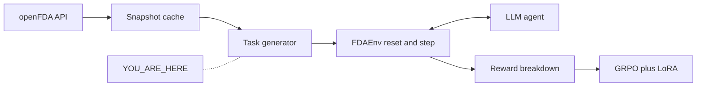

# 02 · Tasks: gold a reward can check

**Track:** tasks · **Branch:** `track/tasks` · **Time:** 15 min

**By the end you can:**
- Compute a task's tier from its features with the rule in [difficulty.py](../fdagym/tasks/difficulty.py#L36).
- Explain why GRPO gets no gradient from a prompt whose gold is wrong or always solved.
- Find the line that refuses a tied FAERS top reaction.

---

## 2. Where this fits



The generator writes `data/tasks/train.jsonl` and `data/tasks/test.jsonl` from `DiskSnapshot("2026-10-15")` and [drugs.txt](../data/snapshots/drugs.txt). The env scores the agent against `gold`. If that gold does not follow from the snapshot, GRPO reinforces a lie and the dashboard curve is fiction.

---

## 3. Concepts

### 3.1 A gold answer is a fact from the snapshot, or it is not gold

<details>
<summary><b>[predict]</b> You remember that Ozempic was approved in 2017. Why is typing 2017 into the task file not allowed, even if you are right?</summary>

GRPO's advantage is `(R_i - mean(R)) / std(R)` inside a group of 8 samples. The reward calls an answer correct only when it matches `gold`. A remembered year is correct until openFDA or your memory is wrong, and then every sample that copies the label gets a fake 0 or a fake 1. The whole group can sit at the same reward, and the gradient is 0. Gold has to be recomputed from the frozen snapshot, which is what [_approval](../fdagym/tasks/generators.py#L213) does.
</details>

The generator never asks a model. It reads `Snapshot.get` with queries from [plan.py](../fdagym/tasks/plan.py#L63), then keeps a task only when one value survives. A FAERS top reaction with two terms at the same count is dropped here:

```52:61:fdagym/tasks/validate.py
def unique_top_term(results: list[dict]) -> str:
    """The top FAERS reaction, or a rejection when the list is empty or tied."""
    if not results:
        raise TaskRejected("empty faers reactions")
    top = results[0]
    term = str(top.get("term") or "").strip()
    require_nonempty(term, "faers term")
    if len(results) > 1 and top.get("count") == results[1].get("count"):
        raise TaskRejected("tied faers top reaction")
    return term
```

<details>
<summary><b>[recall]</b> Xanomeline's unfiltered top term is NAUSEA (FG-1498). Why does a British MedDRA spelling belong on the task as an alias, not inside the reward as a hidden spellchecker?</summary>

The alias is part of the gold, computed by [aliases](../fdagym/tasks/meddra.py#L37) and stored on the task. The reward can check it without knowing MedDRA. A hidden spellchecker would accept answers the audit sheet never showed you. NAUSEA has no US variant, so FG-1498 carries no aliases. Warfarin's top term `INTERNATIONAL NORMALISED RATIO INCREASED` does (`...NORMALIZED...`).
</details>

### 3.2 The tier is one function, and that is what stage 1 trains on

<details>
<summary><b>[predict]</b> "In what year did the FDA approve the original NDA for OZEMPIC?" takes one search_approvals call. The difficulty doc's example row says easy. What tier does the function actually return, and why?</summary>

Medium. OZEMPIC appears on NDA213051 and NDA209637. The gold year is the earlier one, 2017, citation `NDA209637`. Comparing two applications sets `needs_aggregation` and `needs_disambiguation`. Glucophage is a single NDA, so metformin stays easy. See [generators.py:267](../fdagym/tasks/generators.py#L267).
</details>

First match wins. Hard, then easy, then medium:

```36:47:fdagym/tasks/difficulty.py
def tier(f: Features) -> Tier:
    """First match wins: hard, then easy, then medium."""
    if f["sources"] >= 2 or f["min_tool_calls"] >= 4 or (f["needs_aggregation"] and f["has_constraint"]):
        return "hard"
    if (
        f["sources"] == 1
        and f["min_tool_calls"] <= 2
        and not f["needs_disambiguation"]
        and not f["needs_aggregation"]
    ):
        return "easy"
    return "medium"
```

Stage 1 of the curriculum is 60% easy, 30% medium, 10% hard, and only prompts with `0 < base_pass_rate < 1`. A hand-typed "easy" on a task the model always misses wastes a stage. `base_pass_rate` is null until the training track measures Qwen 8 times. This track only fills the structural half.

<details>
<summary><b>[predict]</b> The first 100 tasks were 10 easy, 38 medium, and 52 hard. Stage 1 wants 60% easy. Why add templates instead of relabeling medium tasks as easy?</summary>

The tier function is the audit. Relabeling would make "easy" a wish, and the fallback in [docs/difficulty.md](../docs/difficulty.md) would fill stage 1 from medium and hard. The four templates are one source, at most two calls, and neither disambiguation nor aggregation, so [tier](../fdagym/tasks/difficulty.py#L36) returns easy by itself. Regenerating from the 150-drug freeze (`DiskSnapshot("2026-10-15")`, [drugs.txt](../data/snapshots/drugs.txt)) produced 681 easy, 297 medium, and 593 hard (1571 tasks). A yes/no boxed warning is emitted only when every label agrees, with no keywords: atorvastatin is No (FG-0827), warfarin is Yes (FG-0922). The "No" citation is field `sections` and the label `set_id`s ([_easy_boxed](../fdagym/tasks/generators.py#L386)). Sponsor, brand, and dosage form name one application number ([_application_facts](../fdagym/tasks/generators.py#L282)), so they are one record. A FAERS "how many" stays hard: it is still aggregation plus a year.
</details>

<details>
<summary><b>[transfer]</b> A serious-FAERS count for one year is one tool call and one source. Why is it hard?</summary>

`needs_aggregation` and `has_constraint` are both true. The third clause of the hard rule fires. Call count never gets a vote. Every serious-year count in this set is hard for that reason. All 150 `faers_count` tasks are hard.
</details>

### 3.3 Train and test do not share a drug

<details>
<summary><b>[predict]</b> Put warfarin's boxed-warning task in train and warfarin's FAERS task in test. What can a high test score mean?</summary>

That the model memorized warfarin. The split is by `generic_name`, seeded with `GenConfig.seed` 7. [assign_splits](../fdagym/tasks/split.py#L13) reads 150 names from [load_universe](../fdagym/tasks/plan.py#L29), keeps 120 in train and 30 in test, and packs empty-window drugs so both sides can hit the 5% cap. The shipped sheet has no overlapping generic name.
</details>

The shipped sheet is the 150-drug freeze, 1571 tasks. Train (1229): 120 drugs, 61 unanswerable (5.0%). Test (342): 30 drugs, 17 unanswerable (5.0%). Tests still generate from the 15-drug fixtures in `tests/tasks/fixtures/`; the jsonl is `drugs.txt`.

### 3.4 Candidate search and task acceptance have different jobs

<details>
<summary><b>[predict]</b> If a sponsor candidate set looks balanced, is that enough to emit a task?</summary>

No. Candidate selection can enforce a private sponsor and rotate the answer, but the question still has to be solved from the snapshot and score 1.0. [generate_hard](../fdagym/tasks/hard.py#L133) injects that acceptance check into [fill_sponsor_tasks](../fdagym/tasks/hard_sponsor.py#L335), so sponsor search does not own task formatting or the reference solver.
</details>

The sponsor module works on profile-shaped records and calls the injected `accept` function before keeping a candidate. That boundary makes candidate rotation readable on its own; changing it still has to preserve generated tasks, which the existing hard-task checksum and oracle tests check.

```python
def fill_sponsor_tasks(
    profiles: list[Any], rng: random.Random, *, quotas: dict[str, int],
    dropped: Counter, accept, named_cap: int, answer_cap: int, anchor_cap: int,
) -> dict[str, list[dict]]:
    index = _sponsor_index(profiles, blocked_sponsors, blocked_apps)
```

<details>
<summary><b>[recall]</b> Which component decides whether a proposed sponsor question is answerable within the tool budget?</summary>

The injected `accept` callback in `hard.py` calls `solve`, checks the gold against a fresh snapshot answer, and verifies the reward. `hard_sponsor.py` owns candidate search, not evidence validation.
</details>

<details>
<summary><b>[why]</b> Why is 5% a cap, not a quota you fill by deleting answerable tasks?</summary>

Only an empty recorded response can be gold `NOT_FOUND`. [_unanswerable_cap](../fdagym/tasks/split.py#L91) keeps as many honest empties as fit under 5%. It does not delete answerable tasks to push a shortfall up to 5%. Doing that would train the model on a made-up rate. [allow_unanswerable](../fdagym/tasks/plan.py#L42) also refuses aprocitentan 2021 and resmetirom 2020–2022: those years have total 1, a possible name collision, not a clean empty.
</details>

---

## 4. Experiments

### 4.1 Glucophage is easy and Ozempic is medium

```bash
uv run python -c '
import json
from pathlib import Path
rows=[]
for name in ("train","test"):
    rows += [json.loads(l) for l in Path(f"data/tasks/{name}.jsonl").read_text().splitlines() if l.strip()]
for name in ("metformin", "semaglutide"):
    t = next(x for x in rows if x["type"]=="approval" and x["gold"]["kind"]=="number" and x["entity"]["generic_name"]==name)
    f = t["difficulty_features"]
    print(name, t["entity"].get("brand_name"), t["gold"]["value"], t["difficulty"], f["needs_disambiguation"], f["needs_aggregation"], t["gold_citations"][0]["ids"], t["split"])
'
```

<details>
<summary><b>[predict]</b> Both questions ask for an original NDA year. Do they land in the same tier?</summary>

No. Output from this tree:

```
metformin GLUCOPHAGE 1995 easy False False ['NDA020357'] train
semaglutide OZEMPIC 2017 medium True True ['NDA209637'] test
```

The year 1995 is Glucophage's ORIG/AP date on `NDA020357`. The year 2017 is the ORIG/AP date on `NDA209637`. The Ozempic tier is medium because a second application also lists the brand OZEMPIC.
</details>

### 4.2 Five percent on both splits, and a total of 1 is not empty

```bash
uv run python -c '
import json
from pathlib import Path
rows=[]
for name in ("train","test"):
    part=[json.loads(l) for l in Path(f"data/tasks/{name}.jsonl").read_text().splitlines() if l.strip()]
    n=sum(not t["answerable"] for t in part)
    print(name, len(part), "unans", n, f"{100*n/len(part):.1f}%", "drugs", len({t["entity"]["generic_name"] for t in part}))
    rows += part
print("aprocitentan unans years", sorted({t["oracle_calls"][0]["arguments"].get("year") for t in rows if (not t["answerable"] and t["entity"]["generic_name"]=="aprocitentan")}))
print("resmetirom unans years", sorted({t["oracle_calls"][0]["arguments"].get("year") for t in rows if (not t["answerable"] and t["entity"]["generic_name"]=="resmetirom")}))
'
```

<details>
<summary><b>[predict]</b> Aprocitentan 2021 has one FAERS report. Are 2021 tasks gold NOT_FOUND? Does test have zero unanswerable rows, like the 10-drug pilot?</summary>

No and no. 2021 is not in aprocitentan's unanswerable years. Resmetirom's only empty gold is 2023. Test holds 17 unanswerable tasks (5.0%), same share as train.

```
train 1229 unans 61 5.0% drugs 120
test 342 unans 17 5.0% drugs 30
aprocitentan unans years [2020, 2022, 2023, 2024]
resmetirom unans years [2023]
```
</details>

### 4.3 Hard-task generator after the extraction

```bash
uv run python -c 'from fdagym.tasks.hard import generate_hard; from fdagym.openfda import DiskSnapshot; tasks, report = generate_hard(DiskSnapshot("2026-10-15")); print(report["n"], report["by_variant"])'
```

<details>
<summary><b>[predict]</b> Did moving sponsor candidate search change the number of generated tasks or the per-variant quotas?</summary>

No. Output from this tree: `100 {'earliest_boxed': 16, 'faers_year': 12, 'faers_reaction': 18, 'boxed_none': 4, 'sponsor_faers': 25, 'sponsor_drug': 25}`. The refactor moved the candidate search boundary; the seeded generator and stable task ordering remain in `hard.py`.
</details>

---

## 5. Break it

In [config.py](../fdagym/tasks/config.py#L12), change `single_record_earliest_is_aggregation` from `False` to `True`.

<details>
<summary><b>[predict]</b> Which test fails, and what does the assertion compare?</summary>

`test_combination_application_cannot_set_the_approval_year`. The toy drug has one single-ingredient NDA, so the flag is the only thing that can set aggregation. With the flag on, the tier function returns medium. The failure we got:

```
assert approval["difficulty"] == "easy"
AssertionError: assert 'medium' == 'easy'
```

Revert with `git checkout -- fdagym/tasks/config.py`.
</details>

---

## 6. Decisions I made

**Universe is drugs.txt, not a 15-name tuple.** [load_universe](../fdagym/tasks/plan.py#L29) is the default. ibuprofen is not on that list (1137 labels > `LABEL_LIMIT` 1000); diclofenac replaced it. The generator refuses to write an ibuprofen row.

<details>
<summary><b>[why]</b> If you added ibuprofen back to drugs.txt and raised LABEL_LIMIT without a new recording, what would gold for "does it have a boxed warning?" actually measure?</summary>

The first 1000 labels, not the drug. Prescription and OTC ibuprofen labels already disagree, so the honest generator emits no unanimous boxed task. A truncated page would also hide labels the citation list never saw. Drop the drug or re-record; do not pretend the page is complete.
</details>

**Empty reaction list vs count 0.** Top-reaction gold is `NOT_FOUND` when the union query returns no rows. A count gold stays the integer in `meta.results.total`, including 0. Empty top-reaction citations use field `meta.results.total`. A real top term cites field `results`. Both use `ids: []`.

<details>
<summary><b>[transfer]</b> A model answers "0" to FG-1112 and FG-1493, with a grounded citation of the empty payload. What should correctness be on each?</summary>

1 on FG-1112, 0 on FG-1493. FG-1112 asks how many serious xanomeline reports were received in 2022; gold is the number 0. FG-1493 asks for the most-reported reaction in 2022; gold is `NOT_FOUND`. The number 0 is the count question's gold, not a top-reaction answer.
</details>

**5% is a cap, and both splits get some.** 61 of 1229 train tasks and 17 of 342 test tasks are honestly unanswerable (both 5.0%). We do not delete answerable tasks to make that 5%. Label-open stays capped near 10% (train 5.6%, test 5.3%). The sheet is 681 easy, 297 medium, 593 hard. Test hosts 6 easy Yes and 6 easy No boxed-warning tasks.

---

## 7. Gotchas in the real data

- **A generic-name search returns combination products.** Metformin hits Janumet. [_product_is_single](../fdagym/tasks/generators.py#L833) keeps a product only when its only ingredient is the drug. The toy test's combo NDA is dated 2001. The gold stays 1995, the single-ingredient NDA, now Glucophage `NDA020357` (FG-0591).
- **The approvals page is 1,000 rows.** At a page of 100, metformin's earliest single-ingredient ORIG looked like Riomet 2003. The freeze stored 214 of 214 applications, including Glucophage.

<details>
<summary><b>[predict]</b> openFDA returns 0 finerenone reports for patient.drug.openfda.generic_name and 2,960 for patient.drug.activesubstance.activesubstancename. If gold is NOT_FOUND, what does GRPO learn?</summary>

To abstain on new drugs. openFDA fills `openfda.generic_name` only for drugs it has mapped, and newer ones often are not mapped. The first generator trusted the 404. Training would have paid the model for saying `NOT_FOUND` on finerenone, mavacamten, and vericiguat, which do have reports. [_faers_drug](../fdagym/queries.py#L32) ORs both fields. The 150-drug freeze recorded that union. Aprocitentan 2021 and resmetirom 2020–2022 still show total 1 on the union; those are not clean empties, so they are not `NOT_FOUND` golds even if the serious-only slice is empty.
</details>

- **Boxed warnings disagree inside one drug.** Diclofenac is the ibuprofen replacement (443 labels). OTC vs prescription do not agree, so there is no easy yes/no diclofenac task; FG-0836 is the OTC "No" with a scope. Warfarin agrees: 74 labels, keyword `bleeding`, all 74 `set_id`s on FG-0921.
- **MedDRA is British.** Warfarin's top term `INTERNATIONAL NORMALISED RATIO INCREASED` gets the alias `...NORMALIZED...`.
- **Do not say "as suspect drug."** A FAERS report is a list of drugs. openFDA does not bind two filters to the same list element. None of the 1571 questions contain "suspect".

`uv run pytest -q` reported `125 passed`. `uv run ruff check .` reported `All checks passed!` Oracle: 627/627 approval, 131/131 boxed_warning, 86/86 composite, 150/150 faers_count, 490/490 faers_top_reaction; 87 label_open skipped (judge not implemented).

---

## 8. Checkpoint

Run `python3 scripts/quiz.py learn/02-tasks.md`.

Then answer these in chat:

- **a.** FG-1112 gold is 0 and FG-1493 gold is `NOT_FOUND`. Write the reward for an agent that answers `0` on both, with a grounded citation of the empty payload, and valid JSON. Use the formula in [AGENTS.md](../AGENTS.md).
- **b.** Ozempic's approval task is medium, and [docs/difficulty.md](../docs/difficulty.md) now says so. What do you lose in the audit if you clear both flags and force that task back to easy?
- **c.** Aprocitentan 2021 is total 1 on the union query. Would you ship that year as a count gold of 1, as `NOT_FOUND`, or drop it? What would you check before trusting it?

I will read `learn/answers/02-tasks.jsonl` and go through anything you mark `p` or `n`.

---

## 9. Read next

- [docs/difficulty.md](../docs/difficulty.md). The stage table. This lesson only builds the structural tier the table consumes.
- [learn/00-orientation.md](00-orientation.md) §3.3. Why a group of eight equal rewards teaches nothing. That is the reason gold has to be checkable.
- [schemas/task.schema.json](../schemas/task.schema.json). The fields the env is allowed to read. `base_pass_rate` is null on every row we wrote.
