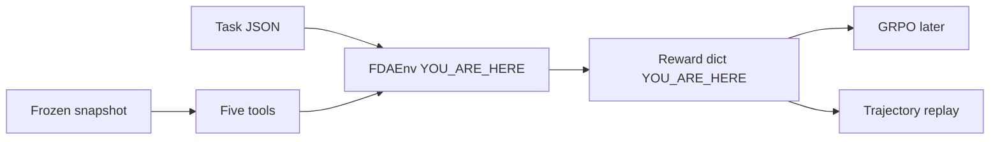

# 03 · Env and rewards: the score GRPO will chase

**Track:** env · **Branch:** `track/env` · **Time:** 15 min

**By the end you can:**
- Walk one warfarin episode through `reset` and `step` and read the reward dict it returns.
- Compute a trajectory total by hand from the four weights.
- Name the test that fails if a correct guess no longer needs a citation.

---

## 2. Where this fits



GRPO will maximize `reward.total`. If that number pays for a guess, the trained model guesses.
The dashboard replays the trajectory dict this env records, so a missing field there breaks replay later.

---

## 3. Concepts

### 3.1 A right answer with no citation from this episode scores 0.10

<details>
<summary><b>[predict]</b> Metformin's top FAERS reaction is NAUSEA. The agent submits NAUSEA and calls no tool. What is total?</summary>

**0.10.** Format is 1, so it contributes 0.10. Citation is 0. The gate in `score_correctness` forces correctness to 0, and efficiency is not counted while correctness is 0.
The common wrong answer is **0.75**, which is what [00-orientation.md](00-orientation.md) got before this gate existed: 0.60 for the right word, plus 0.10 format, plus 0.05 efficiency.
</details>

Weights live in one place: [combine.py:8](../fdagym/rewards/combine.py#L8).

```python
WEIGHTS = {"correctness": 0.60, "citation": 0.25, "format": 0.10, "efficiency": 0.05}
```

The gate is the next check in [correctness.py:39](../fdagym/rewards/correctness.py#L39). Change that comparison and the NAUSEA guess scores 0.75 again. Section 5 does exactly that.

```python
if not format_ok:
    return 0.0, ["correctness forced to 0: invalid format"]
# Break-it: change `< 1` to `< 0`. An ungrounded guess then keeps its raw score.
if valid_citations < 1:
    return 0.0, ["correctness gated: no valid citation"]
```

<details>
<summary><b>[recall]</b> The quitter submits "unknown" with valid JSON and no tools, and also scores 0.10. If you delete the gate, which of the two totals jumps to 0.75?</summary>

Only the NAUSEA guess. "unknown" still fails the warfarin boolean check, so correctness stays 0 and the total stays 0.10.
The common mistake is to say both jump. The gate only matters when the answer text would have been marked correct.
</details>

### 3.2 The quote has to match text this episode showed

<details>
<summary><b>[predict]</b> The agent cites warfarin set_id 0cbce382-9c88-4f58-ae0f-532a841e8f95 and a real bleeding sentence, but calls no tool. What is the citation score?</summary>

**0.** The id never appeared in a tool output of this trajectory, so the citation is invalid and the gate also zeros correctness. Total is 0.10.
`test_memorized_set_id_never_retrieved_in_this_trajectory` locks that. The common wrong answer is 1, because the sentence really is on the label in the snapshot.
</details>

A quote longer than the field text fails even when the field is a prefix of the quote. A field of 12 characters or fewer needs a full-string match. A longer field still allows a substring, but not one shorter than 4 characters. The branch is [citation.py:176](../fdagym/rewards/citation.py#L176).

```python
if len(left) > len(right):
    return False, "quote longer than field text"
if len(right) <= _SHORT_FIELD:
    score = ratio(left, right, processor=str.lower)
else:
    if len(left) < _MIN_QUOTE:
        return False, "quote shorter than 4 characters"
    score = partial_ratio(left, right, processor=str.lower)
```

<details>
<summary><b>[predict]</b> The 2025 serious metformin count is 20254. The agent quotes "1" against meta.results.total. What is the citation score?</summary>

**0.** The field text is 5 characters, so the quote has to match the whole value at 0.9 or above. "1" does not match "20254". Total for that episode is 0.10, because the right answer is then gated.
"20254" and "0" still pass, and "NAUSEA" still passes against the long results list. `test_one_character_quote_does_not_validate` and `test_short_quotes_keep_whole_values_and_nausea` lock those.
The common wrong answer is 1, which is what `partial_ratio("1", "20254")` returns on its own.
</details>

<details>
<summary><b>[transfer]</b> The agent calls get_label_section, then quotes that field text plus the words "and an invented clause". Does the citation pass?</summary>

No. The quote is longer than the field text, so it fails before the fuzzy score. `test_quote_longer_than_the_field_does_not_match` uses the field `BLEEDING` and the quote `BLEEDING and an invented clause`.
</details>

<details>
<summary><b>[predict]</b> Why does a No on "Does atorvastatin's label carry a boxed warning?" still need a citation, and what stops an agent that always answers No?</summary>

An ungrounded No scores 0.10. The gate in [correctness.py:39](../fdagym/rewards/correctness.py#L39) zeros correctness when this trajectory has no valid citation, so format is the only point.
The citation for a missing section is the label's `set_id` and the field `sections`. [citation.py:214](../fdagym/rewards/citation.py#L214) turns that list into text, and the quote has to match it. A set_id `search_drug_label` did not return in this episode does not count.
Always answering No also fails a yes-task. Warfarin gold is true, so the answer has to start with yes and hit the bleeding keyword.
On the pilot, atorvastatin has a boxed warning on 0 of 259 labels. A grounded No scores 1.0. Yes, with the same citation, scores correctness 0. A task with no topic has no keywords, so yes/no alone decides ([correctness.py:135](../fdagym/rewards/correctness.py#L135)). `test_pilot_atorvastatin_absence_is_cited_from_sections`.
The common wrong guess is that No is free, because there is no section text to quote.
</details>

### 3.3 Efficiency uses the task minimum, and only after a correct answer

<details>
<summary><b>[predict]</b> Four tool calls, a wrong answer, and one valid citation of the right field. What is total?</summary>

**0.35.** Citation is 1, so 0.25, plus format 0.10. Correctness is 0, so efficiency stays 0. That is the honest searcher in [00-orientation.md](00-orientation.md) section 5b.
The common wrong answer adds an effort bonus for the four calls. We do not. `test_honest_searcher_with_the_right_evidence_and_the_wrong_answer` asserts 0.35.
</details>

[efficiency.py](../fdagym/rewards/efficiency.py) counts distinct `(tool, arguments)` pairs, and skips `submit_answer`. Four copies of one search count as one call. A trace shorter than `min_tool_calls` scores `calls / min_tool_calls`. A longer trace scores `min_tool_calls / calls`.

```python
calls = _distinct_calls(steps)
minimum = int(task["difficulty_features"]["min_tool_calls"])
if correctness <= 0:
    return 0.0, [f"efficiency not counted: correctness is 0 ({calls} distinct tool calls)"]
if calls < minimum:
    score = calls / minimum
```

`submit_answer` is not a tool call. A correct guess with no tool calls scores efficiency 0, because zero distinct calls is under the minimum.

<details>
<summary><b>[transfer]</b> Correct answer, 2 of 3 citations valid, 3 tool calls, min_tool_calls 2. What is total?</summary>

**0.90.** `0.60 + 0.25 * (2/3) + 0.10 + 0.05 * (2/3)`. The orientation formula used `1 - 3/6` for efficiency and got about 0.89. That formula punished hard tasks. This one pays 1.0 when the distinct call count equals the task minimum.
`test_worked_example_two_of_three_citations_and_three_calls` asserts 0.90. The notes line from that score is `total 0.9000 = 0.60*1.0000 + 0.25*0.6667 + 0.10*1.0000 + 0.05*0.6667`.
</details>

### 3.4 A boxed-warning answer may name at most two topics

<details>
<summary><b>[predict]</b> Before the topic cap, what total did "Yes. bleeding nausea death cancer liver stroke infarct hemorrhage" get on the warfarin task, with a real citation and two tool calls?</summary>

**1.00.** It starts with yes, it contains the gold keyword bleeding, the citation was valid, and two calls match `min_tool_calls` 2, so efficiency was 1. The common wrong guess is 0.10, as if extra words already zeroed correctness.
</details>

The cap is [correctness.py:132](../fdagym/rewards/correctness.py#L132). Topics are `WARNING:` headings plus synonyms, in [boxed_topics.json](../fdagym/rewards/boxed_topics.json), built by [topics.py](../fdagym/rewards/topics.py) from a Snapshot. Bleeding and hemorrhage are one topic. The stuffed sentence names six.

<details>
<summary><b>[predict]</b> After the cap, what is that stuffed answer's correctness, and what note does the reward carry?</summary>

Correctness is **0**. The note is `correctness: answer names 6 boxed-warning topics (max 2)`. The citation is still valid, so total is **0.35**, not 0.10. `test_stuffed_boolean_keywords_name_too_many_topics` asserts both.
The honest sentence "Yes. Bleeding risk: warfarin can cause major or fatal bleeding." names one topic, BLEEDING RISK, and still scores 1.0.
</details>

<details>
<summary><b>[why]</b> A token-ratio rule, keywords hit over content tokens, would have scored that honest sentence about 1/7. Why is that the wrong penalty?</summary>

After "Yes" the sentence is about seven content words and only one of them is the gold keyword. The rest is the explanation we want: risk, warfarin, major, fatal bleeding. A ratio would mark our own correct answer as a miss.
The cap counts distinct boxed-warning topics, not tokens. "fatal" is not a separate topic, so the sentence names one.
</details>

---

## 4. Experiments

### 4.1 One warfarin episode

<details>
<summary><b>[predict]</b> You search labels, then fetch the boxed warning. Is total already 1.0 on that second step, or only after submit_answer?</summary>

Only after `submit_answer`. The second step returns reward 0.0 and `done` false. The section text starts `WARNING: BLEEDING RISK`. After a yes-bleeding answer with that quote, total is 1.0.
The common wrong guess is that fetching the section already scores the episode.
</details>

```bash
uv run python -c '
import json
from fdagym.env import FDAEnv
from tests.env.support import ALL_TASKS, JsonSnapshot, cite, WARFARIN_SET
env = FDAEnv(JsonSnapshot(), ALL_TASKS)
print("reset keys", sorted(env.reset("FG-0001")))
env.step({"tool":"search_drug_label","arguments":{"generic_name":"warfarin","has_section":"boxed_warning"}})
obs, reward, done, info = env.step({"tool":"get_label_section","arguments":{"set_id":WARFARIN_SET,"section":"boxed_warning"}})
print("after tools", done, reward, obs["output"]["boxed_warning"][:70])
quote = "Warfarin sodium can cause major or fatal bleeding"
obs, reward, done, info = env.step({"tool":"submit_answer","arguments":{"answer":"Yes. Bleeding risk: warfarin can cause major or fatal bleeding.","citations":[cite("drug/label", WARFARIN_SET, "boxed_warning", quote)]}})
print("done", done, "total", reward)
print(json.dumps(info["reward"]["notes"], indent=2))
'
```

That printed, on Oct 15:

```text
reset keys ['question', 'tools']
after tools False 0.0 WARNING: BLEEDING RISK Warfarin sodium can cause major or fatal bleedi
done True total 1.0
[
  "format: answer matches the schema",
  "citation 1/1 valid",
  "valid: 0cbce382-9c88-4f58-ae0f-532a841e8f95 boxed_warning (quote fuzzy 1.00)",
  "boolean: polarity and keyword match",
  "efficiency 1.00: min_tool_calls 2 over 2 tool calls",
  "total 1.0000 = 0.60*1.0000 + 0.25*1.0000 + 0.10*1.0000 + 0.05*1.0000"
]
```

`reset` returns the question and the five tool schemas. `step` returns `(observation, reward, done, info)`. Reward stays 0 until the episode ends. The budget of 6 is in [env.py:54](../fdagym/env.py#L54): a seventh tool call ends the episode, and `submit_answer` is still accepted after six calls.

### 4.2 The attack file

<details>
<summary><b>[predict]</b> pytest on tests/rewards/test_adversarial.py: how many tests pass now that the two holes are closed?</summary>

**15 passed, 0 xfailed.** Stuffing scores 0.35. The one-character quote scores 0.10. The common wrong guess is that those two still show up as `x`.
</details>

```bash
uv run pytest -q tests/rewards/test_adversarial.py
```

```text
...............                                                          [100%]
15 passed in 0.04s
```

The passing totals that file asserts:

| Test | Total |
|---|---|
| quitter, no tools, answer "unknown" | 0.10 |
| six citations to fields the task does not accept | 0.10 |
| four calls, wrong answer, one good citation | 0.35 |
| three calls, then broken JSON | 0.00 |
| NAUSEA, no tools | 0.10 |
| real set_id, never retrieved this episode | 0.10 |
| right id and field, invented quote | 0.10 |
| answer "NAUSEA or DIARRHOEA" with a good citation | 0.35 |
| NOT_FOUND on an answerable task, good citation | 0.35 |
| wrong term, one call, min_tool_calls 1 | 0.35, efficiency 0 |
| step:1 from a warfarin search on a metformin task | 0.10 |
| NOT_FOUND on lecanemab 2020 with no search | 0.10 |
| correct, 2 of 3 citations, 3 calls, min 2 | 0.90 |
| stuffed yes-answer naming 6 boxed-warning topics | 0.35, correctness 0 |
| quote "1" against the count 20254 | 0.10 |

---

## 5. Break it

In [correctness.py:39](../fdagym/rewards/correctness.py#L39), change `< 1` to `< 0`. Leave the format check alone.

<details>
<summary><b>[predict]</b> Which test fails, and what total does the NAUSEA guess get?</summary>

`test_always_nausea_without_tools` fails. Obtained total **0.75**, expected 0.1. Correctness becomes 1.0, citation stays 0, format stays 1, and efficiency becomes 1.0 because zero tool calls uses a denominator of 1 and `min_tool_calls` is 1.
The common wrong guess is the quitter test. That answer is still wrong, so it keeps scoring 0.10.
</details>

```bash
uv run pytest -q tests/rewards/test_adversarial.py::test_always_nausea_without_tools --tb=line
```

The failure line from that run:

```text
AssertionError: {'total': 0.75, 'correctness': 1.0, 'citation': 0.0, 'format': 1.0, ...}
assert 0.75 == 0.1 ± 1.0e-09
```

Revert with `git checkout -- fdagym/rewards/correctness.py`.

---

## 6. Decisions I made

**Partial credit for numbers is a line.** Inside the task's tolerance, score is `1 - relative_error / tolerance`, so it is 0 right at the edge. A flat 0.5 inside the window was the other option. The task owns `tolerance`. At 0, only an exact number scores. See [correctness.py:95](../fdagym/rewards/correctness.py#L95).

<details>
<summary><b>[why]</b> Gold is 20254 and tolerance is 0.1. The agent answers 19241. What score should correctness be, and why should the task set the tolerance rather than the reward?</summary>

Relative error is 1013/20254, about 0.0500, so the score is about 0.500. The reward code should not invent "10% is close enough". A count task and a year task do not want the same window. `test_number_is_exact_and_partial_inside_tolerance` locks the line. 18000 is about 11% low on this count, so tolerance 0.1 rejects it. The union search moved the 2025 serious total from 18629 to 20254.
</details>

**The seventh tool call ends the episode.** `submit_answer` still works once six calls have run. The other option was to keep returning errors forever and wait. A replay needs a `terminated_by`. [env.py:54](../fdagym/env.py#L54).

<details>
<summary><b>[why]</b> The trainer uses six tools and then calls a seventh tool instead of submit_answer. Which terminated_by should the replay show?</summary>

`max_steps`. The trajectory records the refusal and a format score of 0, because there is no answer. `test_seventh_tool_call_stops_without_running_the_tool` checks that the seventh call does not hit the snapshot. If the trainer submits after six calls, `terminated_by` is `submit`.
</details>

**Spellings live on the task.** `diarrhea` matches only when `gold.aliases` says so. A US/UK dictionary inside the reward was the other option. The generator sees the snapshot term and can attach the alias. A hidden list would change scores without a task diff.

<details>
<summary><b>[transfer]</b> Gold value is DIARRHOEA and the task has no alias. The agent answers diarrhea after a valid citation. What is correctness?</summary>

0. Normalization lowercases and trims. It does not translate spelling. Add `"diarrhea"` to `aliases` on that task if both should count.
</details>

---

## 7. Gotchas in the real data

- **Ozempic was missing until the approvals query changed.** `openfda.generic_name:"semaglutide"` returned 1 application. `products.active_ingredients.name` returns 6. NDA209637 has an empty `openfda` object, brand OZEMPIC, and original approval `20171205`. `test_recorded_keys_match_the_query_contract` reads that from `tests/env/fixtures/openfda.json`. The tool test then scores answer `2017` at total 1.0.
- **The warfarin fixture keeps 5 labels, and the API total is 74.** Page 1 shows those 5. Page 2 is empty. `test_warfarin_page_two_is_empty_because_the_fixture_keeps_five_labels`. A full snapshot should store every record the total counts, with long fields trimmed. This fixture does not.
- **The 1,500-character cut does not fire on this boxed warning.** The text the tool returned is 948 characters, which you saw in section 4.1. `test_long_sections_are_cut_at_1500_and_the_output_says_so` uses a 2,000-character section and checks the note. The cut is in [tools.py:169](../fdagym/tools.py#L169).
- **The union search changed the metformin count.** Serious reports in 2025 are 20254, not 18629. Lecanemab in 2020 is still an empty result under the same union. Seven FAERS calls were re-recorded. Approvals were re-keyed to limit 1000 without another download, because all 6 applications were already in the file.
- **A valid citation still unlocks the full correctness score** even when the quote does not state the answer. JP accepted that for v1. Checking entailment needs the judge, and [correctness.py](../fdagym/rewards/correctness.py) still raises `NotImplementedError` for `kind: judge`.
- **Atorvastatin has no boxed warning in the pilot.** 0 of 259 labels. The No is cited from `search_drug_label`'s `sections` list, not from a section that is not there. `test_pilot_atorvastatin_absence_is_cited_from_sections`. Metformin page 1 of that same snapshot returns 10 labels and total 365.

---

## 8. Checkpoint

Run:

```bash
python3 -c "import sys;sys.path.insert(0,'scripts');import quiz;from pathlib import Path;print(len(quiz.parse(Path('learn/03-env-rewards.md'))))"
```

Then answer these in chat, not in the quiz:

1. `STROKE` and `MYOCARDIAL INFARCTION` are separate topics so the stuffed sentence names 6. If the full snapshot has one heading that covers both, should `build_topics` collapse them?
2. "fatal" in the honest warfarin sentence is not a mortality topic. Should it ever be, given that the sentence would then name 2 topics and still score 1?
3. The serious-metformin-2025 total moved from 18629 to 20254. When the snapshot is regenerated, who updates gold: the task track, or a test that reads the fixture?

Then stop. When you say you are done, I will read `learn/answers/03-env-rewards.jsonl` and go through every `p` or `n`.

---

## 9. Read next

- [00-orientation.md](00-orientation.md) section 5b: the four agents, and why the honest searcher outscores the quitter.
- [trajectory.schema.json](../schemas/trajectory.schema.json): the dict the dashboard will replay. `model` and `usage` are filled by the caller, not by `FDAEnv`.
- [difficulty.md](../docs/difficulty.md): `min_tool_calls` is the denominator of efficiency, recorded by the task generator.
