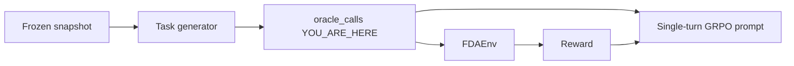

# 04 · Integration: an oracle is a contract test between two teams

**Track:** integration · **Branch:** `track/integration` · **Time:** 15 min

**By the end you can:**
- Run one task's `oracle_calls` through `FDAEnv` and read a reward below 1.0 as a disagreement between the generator and the scorer.
- Name the tool-output field a citation needs, and check that the field is actually there.
- Say what single-turn GRPO puts in the prompt from `oracle_calls` before the model writes an answer.

---

## 2. Where this fits



The task track writes the gold. The env track writes the score. Neither team runs the other's code on the full pilot.
If those two disagree, GRPO will chase a reward a perfect agent cannot earn, and the dashboard will plot that number.

---

## 3. Concepts

### 3.1 The oracle is a third team that only plays the recorded calls

<details>
<summary><b>[predict]</b> Task FG-0026 asks for the dosage form of NDA020702. Gold is TABLET, and gold_citations names the field products. search_approvals used to return application_number, sponsor_name, brand, and submissions. What is the reward if the oracle quotes TABLET from a field the tool never returned?</summary>

**0.1.** I deleted `products` from that tool output and rescored the same answer. The note was `invalid: NDA020702 products field not in the tool output`, then `correctness gated: no valid citation`, then `total 0.1000 = 0.60*0.0000 + 0.25*0.0000 + 0.10*1.0000 + 0.05*0.0000`. Format is the only point left. The common wrong guess is 0.35, which is what you get when the citation is valid and the answer is wrong. Here the citation never became valid, so the 0.25 is gone too.
</details>

A perfect agent is a contract test. It does not search. It runs the calls the generator recorded, cites a field those calls actually returned, and submits the gold. [tests/integration/test_oracle.py](../tests/integration/test_oracle.py) does that for every row in `data/tasks`. Anything under 1.0 is a bug in the gold, the citation, the tool output, or the reward. It is not a model failure.

With `products` restored, FG-0026 scores 1.0. The tool now copies `brand_name`, `dosage_form`, `route`, and `active_ingredients` onto each application, at [tools.py:219](../fdagym/tools.py#L219).

```python
"products": _application_products(record),
```

<details>
<summary><b>[recall]</b> Why does a right answer with a citation of a missing field score 0.1 and not 0.70?</summary>

Correctness is forced to 0 until at least one citation is valid, and efficiency is not counted while correctness is 0. Format still matches the answer schema, so the total is 0.10. 0.70 would be 0.60 plus 0.10, which is the score before that gate.
</details>

### 3.2 oracle_calls is the query the generator already ran

<details>
<summary><b>[predict]</b> The old helper queries_for_task read the year and the word serious out of the question string with a regex. A composite question says "received in 2022" and also mentions the label. Which snapshot queries does that regex recover, and which call does it miss if the label evidence is a second tool?</summary>

It recovered the FAERS count for that year, and a label search, by guessing from the sentence. It could not name `get_label_section`, the page, or `has_section`, because those never appear in the question. The generator already knew them. Recording the calls removes the guess.
</details>

`queries_for_oracle` walks `oracle_calls` and builds the snapshot query from the arguments. `get_label_section` adds nothing, because that call reads a `set_id` the search already stored.

[plan.py:66](../fdagym/tasks/plan.py#L66) walks the recorded calls.

```python
def queries_for_oracle(calls: list[dict]) -> list[Query]:
    found: list[Query] = []
    for call in calls:
        query = _query_for_call(call)
        if query is not None and query not in found:
            found.append(query)
    return found
```

`require_oracle_calls` rejects a task whose call list is a different length from `min_tool_calls`. Efficiency is `min_tool_calls / calls` once the answer is right, so a short list would pay the oracle a perfect efficiency score for a path the features claim is longer.

<details>
<summary><b>[transfer]</b> Plan A in docs/PLAN.md section 7 trains GRPO on one turn. The prompt already contains the tool outputs. Where do those outputs come from?</summary>

From `oracle_calls`, run offline, plus a couple of distractor documents. The model then writes the answer and the citations. The same reward applies. The calls are the pre-fetched context, so a wrong call list trains the model on evidence that does not support the gold.
</details>

### 3.3 A missing section is cited from the search summary

<details>
<summary><b>[predict]</b> FG-0057's gold is "23645; no" for atorvastatin. The label citation used to name the field boxed_warning. You call get_label_section on set_id 00afce9b-48c9-487a-a738-e359c005c707 for that section. What does the tool return, and can that output validate the citation?</summary>

The tool returns `section boxed_warning is not on label 00afce9b-48c9-487a-a738-e359c005c707`. An error output has no `boxed_warning` text, so the quote cannot match. The citation is invalid, correctness is gated to 0, and the oracle cannot score 1.0. Absence is visible on `search_drug_label`: the row's `sections` list omits `boxed_warning`. That is the field the task now accepts.
</details>

The generator records a section read only when the section text is the evidence. For a No, the oracle stops after the search.

[generators.py:636](../fdagym/tasks/generators.py#L636) picks the label field.

```python
citations=[
    {"endpoint": "drug/event", "ids": [], "fields": ["meta.results.total"]},
    {"endpoint": "drug/label", "ids": ids, "fields": ["boxed_warning" if present else "sections"]},
]
```

<details>
<summary><b>[debug]</b> FG-0068 asks how many serious xanomeline reports were received in 2022. Gold is the number 0, and answerable is true. The oracle submits NOT_FOUND with a valid citation of meta.results.total. Total comes back 0.35. Which component is 0, and why is 0 a real answer?</summary>

Correctness is 0. The note path is `NOT_FOUND on an answerable task`. Citation stays 1 and format stays 1, so the total is 0.25 + 0.10. A count of zero is a number the snapshot returned. NOT_FOUND is reserved for tasks marked `answerable: false`, such as an empty top-reaction list.
</details>

---

## 4. Experiments

Run the contract test. It skips when `data/snapshots/2026-10-15` is missing.

```bash
uv run pytest -q tests/integration/test_oracle.py -s
```

<details>
<summary><b>[predict]</b> There are 96 pilot tasks, and 5 of them are label_open. The judge is not implemented. How many tasks print as scored 1.0, and what does the adversarial test require for a wrong answer?</summary>

91 score 1.0. The run printed:

```
skipped label_open: 5
approval: 37/37
boxed_warning: 8/8
composite: 6/6
faers_count: 10/10
faers_top_reaction: 30/30
label_open: skipped 5
```

The adversarial test, one task per type other than `label_open`, submits the oracle's citations with a wrong answer and requires total **0.35**. That is citation 1 times 0.25, plus format 1 times 0.10. Correctness and efficiency are both 0, so a valid quote does not rescue a wrong value.
</details>

Yes/no balance on the regenerated pilot, counting boxed-warning tasks that have no topic keywords:

| Split | Yes | No |
|---|---|---|
| train | 1, adalimumab | 1, atorvastatin |
| test | 1, semaglutide | 0 |

Train had four unanimous Yes tasks and one No. The generator kept adalimumab and dropped the easy Yes tasks for lisinopril, thioridazine, and warfarin. Test has no No drug whose labels agree, so the semaglutide Yes stays. Xanomeline's only label is the combination "XANOMELINE AND TROSPIUM CHLORIDE", so it never became a single-ingredient No.

<details>
<summary><b>[recall]</b> Why does the balancer refuse to add a No task for semaglutide in the test split?</summary>

A No has to be read out of the snapshot. Semaglutide's single-ingredient labels carry a boxed warning. Inventing a No would make the oracle submit a false gold and score 0 on correctness, which is a manufactured disagreement.
</details>

---

## 5. Break it

In [fdagym/tools.py](../fdagym/tools.py) line 219, delete the `"products"` entry so `search_approvals` stops returning that field.

<details>
<summary><b>[predict]</b> Which test fails, and what reward would FG-0026 get if you reran the oracle?</summary>

`test_approvals_expose_products_so_dosage_form_can_be_cited` fails, because the output no longer equals the record's products. FG-0026 would score **0.1** again. The field `products` is gone, so the citation is invalid and correctness is gated off. Revert with `git checkout -- fdagym/tools.py`.
</details>

---

## 6. Decisions I made

**Record the calls in the generator.** The other option was to keep parsing the question. The regex cannot see `has_section`, the page, or `get_label_section`. The generator already holds those arguments, so `oracle_calls` is written at the same place as the gold.

<details>
<summary><b>[why]</b> If openFDA added a tool argument tomorrow, which design breaks first, the regex or the recorded calls?</summary>

The regex breaks first. It only notices words that happen to be in the question. The recorded calls break at generation time, in `require_oracle_calls` and the schema, before a training run.
</details>

**Expose `products` from the tool.** The other option was to change every dosage-form citation to the `brand` list. Route and dosage form are not on `brand`. The task tests already require the field name `products`. The tool was dropping the field the gold names.

**Drop surplus Yes tasks.** The other option was to write extra No tasks until the counts match. The pilot has one unanimous No, atorvastatin. Train is 1 Yes and 1 No. Test is 1 Yes and 0 No, because that split has no agreeing No.

<details>
<summary><b>[transfer]</b> If a later snapshot has three No drugs and one Yes drug in train, what should the balancer do?</summary>

Keep the Yes and keep all three Nos. It only drops Yes, and only when Yes outnumber No. It does not invent Yes tasks either.
</details>

---

## 7. Gotchas in the real data or tools

FG-0057 is the absence case. `get_label_section` for `boxed_warning` on atorvastatin set_id `00afce9b-48c9-487a-a738-e359c005c707` returns the error above. The oracle call list for that task is `query_adverse_events` then `search_drug_label`, and the label field is `sections`. That task scores 1.0.

FG-0068's gold is 0 and `answerable` is true. Submitting `NOT_FOUND` with a valid empty-looking citation still scores 0.35, because the total in the tool output is the number zero, not a missing record. Empty top-reaction tasks are the ones marked `answerable: false`.

Thioridazine's keyword task lists `shown` as a gold keyword. The oracle answer `Yes. shown.` scores 1.0. The reward is doing what the keyword list says. The word is a weak description of the risk, and it is a task-review issue, not a reward bug. I left the keyword rule alone.

---

## 8. Checkpoint

Run:

```bash
python scripts/quiz.py learn/04-integration.md
```

Then answer these three in chat. They are not in the quiz file.

1. FG-0057 used to cite `boxed_warning` for a label that has no such section. If the reward treated the tool's error string as a valid quote of the missing section, what would a trained model learn to submit as evidence?
2. Test has one Yes and zero No. What breaks in the snapshot contract if you add a semaglutide No task so the split looks balanced?
3. Plan A copies `oracle_calls` into the prompt as the only evidence. If those calls stop one page before the `set_id` the citation needs, what reward does every sample get, and why does GRPO get no gradient?

Stop there. When you are done, the integration agent reads `learn/answers/04-integration.jsonl` and answers every row you marked `p` or `n`.

---

## 9. Read next

- [learn/03-env-rewards.md](03-env-rewards.md) shows the four weights and the citation gate this oracle is checking.
- [docs/PLAN.md](../docs/PLAN.md) section 7 is Plan A, the single-turn GRPO setup that prefetches `oracle_calls`.
- [docs/difficulty.md](../docs/difficulty.md) defines `min_tool_calls`, which `require_oracle_calls` now checks against the recorded list.
