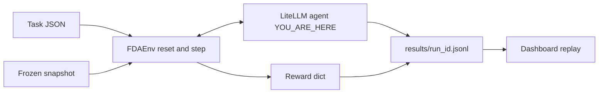

# 05 · Evals: the tool loop, and why a correct guess scores 0.10

**Track:** evals · **Branch:** `track/evals` · **Time:** 15 min

**By the end you can:**
- Trace one LiteLLM `tool_calls` array into `FDAEnv.step` and say when the loop forces `submit_answer`.
- Compute the reward of a correct answer that never cites a tool output from this episode.
- Read one row of `summary.json` and name which field is pass rate (`correctness > 0`).

---

## 2. Where this fits



If this loop writes a trajectory the schema rejects, the dashboard cannot replay it.
If it lets the model skip citing, GRPO will treat 0.10 as "sometimes works" and the baseline table lies.

---

## 3. Concepts

### 3.1 The agent is a translator, not a second environment

<details>
<summary><b>[predict]</b> LiteLLM returns a Chat Completions <code>tool_calls</code> list. What does FDA-Gym's env actually accept as an action?</summary>

A dict `{tool, arguments, thought}`. The env does not speak OpenAI. [litellm_agent.py:111](../fdagym/agents/litellm_agent.py#L111) is the only bridge: parse the function name and JSON arguments, then `env.step`. The common wrong picture is that LiteLLM "runs the tools". It only proposes calls. The snapshot answers them.
</details>

`reset` gives the question plus the five schemas in `TOOLS`. Each model round may emit one or more tool calls. The loop executes them against the frozen snapshot, appends the raw output as a `role: tool` message, and calls the model again. Temperature is 0.2. The cap is 6 tools plus one submit ([env.py:11](../fdagym/env.py#L11), [litellm_agent.py:10](../fdagym/agents/litellm_agent.py#L10)).

```71:82:fdagym/agents/litellm_agent.py
def run_episode(env: FDAEnv, task_id: str, *, model: str, completion=None, temperature: float = TEMPERATURE, kind: str = "baseline") -> dict:
    complete = completion or _completion
    env.model = {"name": model, "kind": kind, "checkpoint_step": None}
    env.usage = {"prompt_tokens": 0, "completion_tokens": 0, "cost_usd": 0.0, "latency_ms": 0}
    obs = env.reset(task_id)
    messages = [
        {"role": "system", "content": SYSTEM_PROMPT},
        {"role": "user", "content": obs["question"]},
    ]
    for _round in range(MAX_LLM_ROUNDS):
        force_submit = env.tool_calls >= TOOL_BUDGET
        tools = [_SUBMIT] if force_submit else TOOLS
```

`env.reset` does **not** zero `usage`. The caller must, or a reused env would bill episode 2 for episode 1's tokens. That is a contract note for anyone else who drives `FDAEnv`.

The system prompt forbids memorized FDA facts and includes a worked warfarin citation (`set_id` `0cbce382-9c88-4f58-ae0f-532a841e8f95`, field `boxed_warning`, quote from the section text). Without that example, a base model that "knows" warfarin bleeds still scores 0.10, because the quote never appeared in *this* episode.

<details>
<summary><b>[recall]</b> Who fills <code>trajectory.model</code> and <code>trajectory.usage</code>: <code>FDAEnv</code> or the agent?</summary>

The agent. `FDAEnv` defaults them to `"unspecified"` and zeros. The property [env.py:94](../fdagym/env.py#L94) just copies whatever the caller left on `env.model` / `env.usage`. The dashboard replay of cost and latency is only as honest as this loop.
</details>

### 3.2 The seventh tool call is a crash unless we submit first

<details>
<summary><b>[predict]</b> The model has already made 6 tool calls and now emits <code>search_drug_label</code> again. If the agent forwards that call, what is <code>terminated_by</code>, and what is format?</summary>

`max_steps`, format **0**. [env.py:54](../fdagym/env.py#L54) ends the episode without running the tool and without a `final_answer`. The common wrong answer is "the env converts it to submit_answer". It does not. The agent has to.
</details>

After `TOOL_BUDGET` calls, the loop offers only `submit_answer` as a tool. If the model still searches, `_actions_from_response` drops that call and injects `{"answer": "NOT_FOUND", "citations": []}` ([litellm_agent.py:180](../fdagym/agents/litellm_agent.py#L180)). Format stays 1. Correctness stays 0.

```180:185:fdagym/agents/litellm_agent.py
    if force_submit:
        actions = [row for row in actions if row["tool"] == "submit_answer"]
        if not actions:
            actions.append(
                {"tool": "submit_answer", "arguments": dict(FORCED_SUBMIT), "_call_id": "call_forced", "thought": None}
            )
```

<details>
<summary><b>[why]</b> Why inject NOT_FOUND instead of crashing the run when the model refuses to submit?</summary>

A missing `final_answer` zeros format, so the trajectory is a 0.00 hole in the mean. A schema-valid abstain is 0.10 and is still a legal replay. The dashboard would rather show a quitter than a broken JSONL line. `test_budget_forces_submit_answer` locks the submit path.
</details>

### 3.3 A correct uncited answer is 0.10, not 0.75

<details>
<summary><b>[predict]</b> Warfarin does have a boxed warning about bleeding. The agent submits that sentence with valid JSON and zero citations, and never calls a tool. What is total?</summary>

**0.10.** Format is 1. Citation is 0. The gate in [correctness.py:39](../fdagym/rewards/correctness.py#L39) forces correctness to 0, so efficiency is not counted. The common wrong answer is **0.75**: 0.60 for the right words plus 0.10 format plus 0.05 for "efficient" zero tools. That was the orientation formula before the gate.
</details>

Weights live in [combine.py:8](../fdagym/rewards/combine.py#L8):

```python
WEIGHTS = {"correctness": 0.60, "citation": 0.25, "format": 0.10, "efficiency": 0.05}
```

This is why a baseline that "answers correctly without citing" looks almost dead in the leaderboard. It is doing the one thing the reward refuses to pay for.

<details>
<summary><b>[transfer]</b> Liquid LFM on FG-0016 (metformin top reaction, gold NAUSEA) called <code>query_adverse_events</code>, then <code>get_label_section</code> with <code>set_id: "metformin"</code> (error), then <code>search_drug_label</code>, then submitted NOT_FOUND with empty citations. What is total, and which term is the only nonzero?</summary>

**0.10**, format only. The tool outputs never became a citation. Notes from the live jsonl: `citation 0/0 valid`, `correctness gated: no valid citation`, `efficiency not counted: correctness is 0 (3 tool calls)`, `total 0.1000 = 0.60*0.0000 + 0.25*0.0000 + 0.10*1.0000 + 0.05*0.0000`. Using tools does not help unless a quote from those outputs is submitted.
</details>

### 3.4 One jsonl line is one dashboard replay

<details>
<summary><b>[predict]</b> <code>FDAEnv.trajectory["id"]</code> is <code>{run_id}/{task_id}/s{seed}</code>. Three models share a run_id and seed. How many unique ids do you get for FG-0001?</summary>

**One**, unless the evals runner patches it. Env does not know there are three models. [baseline.py:158](../fdagym/agents/baseline.py#L158) rewrites `id` to `{run_id}/{model}/{task_id}/s{seed}` before the line is appended, so the dashboard can key a replay. We do not edit `env.py` for that; it is an evals-side contract note.
</details>

`scripts/run_baseline.py` writes `results/<run_id>.jsonl` (schema [trajectory.schema.json](../schemas/trajectory.schema.json)), `results/<run_id>/summary.json` (per-model `n`, `mean_reward`, `pass_rate`, `mean_citation`, `mean_tools`, `cost_usd`), and `results/<run_id>/leaderboard.json` (B1 columns: `name`, `kind`, `mean_reward`, `pass`, `citations`, `tools`). Resume skips `(model, task_id, seed)` already in the jsonl. Spend cap is $5.

`label_open` is skipped: the judge is still `NotImplementedError`. Count them; do not pretend they scored.

### 3.5 An evaluation can finish with missing episodes

<details>
<summary><b>[predict]</b> One model call raises an exception. If the runner keeps going and writes a summary, should that summary say the run is complete?</summary>

No. A failed episode is missing coverage even if all later tasks finish. [baseline.py:236](../fdagym/agents/baseline.py#L236) appends a structured row to `results/<run_id>/failures.jsonl`, marks `summary.json` as `status: incomplete`, and the CLI exits 2. The exception message is intentionally omitted because provider errors can contain credentials.
</details>

```python
failure = append_failure(
    failures_path, model=model, task_id=task["id"], seed=seed, error=exc
)
print(f"FAIL {model} {task['id']} s{seed} {failure['error_type']} (recorded)", flush=True)
continue
```

`terminated_by: error` trajectories are also added to the failure ledger. If an exception created no trajectory, a later successful retry clears the earlier failure from the summary; a schema-valid trajectory that terminates in error remains in the JSONL and keeps the run incomplete.

<details>
<summary><b>[transfer]</b> The summary has 19 trajectory rows for a 20-task run, no `aborted` field, and `failure_count: 1`. Is the run complete, and where do you inspect the missing episode?</summary>

It is incomplete: check `complete`/`status`, then inspect the failure row in `results/<run_id>/failures.jsonl` for model, task ID, seed, and error class. The raw provider message is not persisted.
</details>

---

## 4. Experiments

### 4.1 A fake model that plays the oracle scores 1.0, offline

Pytest never calls OpenRouter. A scripted LiteLLM stand-in returns the task's `oracle_calls`, then a `submit_answer` whose citations were copied from the tool outputs those calls produced.

```bash
uv run pytest -q tests/agents/test_litellm_agent.py::test_scripted_oracle_on_fixture_validates_and_scores_one
```

<details>
<summary><b>[predict]</b> The fixture task is the warfarin boxed-warning example. After search_drug_label and get_label_section, the scripted submit uses the gold yes-bleeding sentence and the boxed_warning quote. What is total, and which test would fail if the quote were invented?</summary>

**1.0.** Output from the same loop, run Oct 16:

```
ORACLE terminated_by submit
ORACLE total 1.0
ORACLE tools ['search_drug_label', 'get_label_section', 'submit_answer']
  format: answer matches the schema
  citation 1/1 valid
  valid: 0cbce382-9c88-4f58-ae0f-532a841e8f95 boxed_warning (quote fuzzy 1.00)
  boolean: polarity and keyword match
  efficiency 1.00: min_tool_calls 2 over 2 tool calls
  total 1.0000 = 0.60*1.0000 + 0.25*1.0000 + 0.10*1.0000 + 0.05*1.0000
```

pytest: `1 passed`. An invented quote fails citation, gates correctness, and lands at 0.10 — the same hole as not citing at all. `test_scripted_oracle_on_pilot_test_task` repeats this on FG-0016 against the disk snapshot.
</details>

### 4.2 The same warfarin sentence, no tools

```bash
uv run python -c '
from fdagym.env import FDAEnv
from tests.env.support import ALL_TASKS, JsonSnapshot, submit
env = FDAEnv(JsonSnapshot(), ALL_TASKS)
env.reset("FG-0001")
_obs, reward, done, info = env.step(submit("Yes. Bleeding risk: warfarin can cause major or fatal bleeding.", []))
print(done, reward)
print(info["reward"]["notes"])
'
```

<details>
<summary><b>[predict]</b> You already know the answer is yes/bleeding. Do you still need a tool?</summary>

Yes, if you want more than 0.10. Real output Oct 16:

```
True 0.1
['format: answer matches the schema', 'citation 0/0 valid', 'correctness gated: no valid citation', 'efficiency not counted: correctness is 0 (0 tool calls)', 'total 0.1000 = 0.60*0.0000 + 0.25*0.0000 + 0.10*1.0000 + 0.05*0.0000']
```

That is `test_correct_answer_without_citations_scores_format_only`. A baseline that "knows FDA" without citing is indistinguishable from the quitter.
</details>

### 4.3 The live TEST split

20 test tasks, 1 `label_open` skipped (FG-0020), 19 run, 1 seed, 3 models, 57 jsonl lines. Requested OpenRouter slugs (`gpt-4o-mini`, `claude-3.5-haiku`, `qwen-2.5-7b-instruct`) all failed closed: 402 on paid endpoints (the key loaded, the account has never purchased credits). The run used three free tool-capable slugs instead. Numbers from [summary.json](../results/baseline-2026-10-16/summary.json):

| model | n | mean reward | pass | citations | tools | cost |
|---|---|---|---|---|---|---|
| nvidia/nemotron-3.5-lightning:free | 19 | 0.1000 | 0.00 | 0.00 | 0.11 | $0 |
| cohere/north-mini-code:free | 19 | 0.1000 | 0.00 | 0.00 | 0.00 | $0 |
| liquid/lfm-2.5-2.6b:free | 19 | 0.0947 | 0.00 | 0.00 | 2.32 | $0 |

<details>
<summary><b>[predict]</b> LFM actually called tools (mean 2.32). Why is it <i>below</i> the two models that barely called any?</summary>

Pass is 0 for everyone, so the only points on the table are format. LFM's FG-0007 submitted arguments that failed the answer schema (`terminated_by: error`, format 0, total 0.00). Mean 18×0.10 + 1×0.00 = **0.0947**. Nvidia and Cohere hit free-tier 429s; the loop forced a schema-valid `NOT_FOUND` with empty citations, so every row is 0.10. Tools without a valid quote do not move the mean. The common wrong guess is that more tools should raise reward.
</details>

`uv run pytest -q` on this worktree, Oct 16: **127 passed in 1.79s**. `uv run ruff check .`: **All checks passed.**

### 4.4 Force one episode error and inspect the run status

```bash
uv run pytest -q -s tests/agents/test_baseline.py::test_run_baseline_persists_episode_failures_and_marks_run_incomplete
```

<details>
<summary><b>[predict]</b> The runner catches the model exception and continues. Does pytest pass, and does the recorded summary call the run complete?</summary>

The behavior test passes while asserting that the summary is incomplete and `failures.jsonl` records the model, task, seed, and error class. Actual output:

```
FAIL broken-model FG-0001 s7 RuntimeError (recorded)
.
1 passed in 1.84s
```
</details>

---

## 5. Break it

In [litellm_agent.py:180](../fdagym/agents/litellm_agent.py#L180), delete the whole `if force_submit:` block (the three statements that filter to `submit_answer` and inject `FORCED_SUBMIT`). Leave the later "if not actions" fallback.

<details>
<summary><b>[predict]</b> Which test fails, and what does the seventh search do to the episode?</summary>

`test_budget_forces_submit_answer` fails. The scripted model emits a 7th `search_drug_label`. Without the filter, that call is forwarded. The env ends with `terminated_by == "max_steps"`, `final_answer is None`, format 0. The test expects `terminated_by == "submit"` and format 1.0. Revert with `git checkout -- fdagym/agents/litellm_agent.py`.
</details>

```bash
uv run pytest -q tests/agents/test_litellm_agent.py::test_budget_forces_submit_answer --tb=line
```

---

## 6. Decisions I made

**Skip `label_open` rather than add a judge.** A cheap OpenRouter judge is possible, but the env still raises `NotImplementedError` for `kind: judge`, and this account had no paid credits anyway. Count the skip (1 of 20 test tasks). The other option was to fail the run.

<details>
<summary><b>[why]</b> If the judge existed tomorrow, would you still skip these tasks in the baseline jsonl, or score them with a different model than the one being tested?</summary>

Score them, but with a *different* model than the one under test, temperature 0, rubric only. Using the candidate as its own judge is how a 0.10 baseline inflates itself. The skip is a hole in n, not a free 1.0.
</details>

**Rewrite `trajectory.id` in the runner, do not change `FDAEnv`.** Env's id collides across models in one run. Patching after `agent.run` keeps the schema and leaves env/rewards/tools alone.

<details>
<summary><b>[transfer]</b> Training later writes 8 GRPO siblings of the same task. What has to be in <code>id</code> besides model, task, and seed?</summary>

A sample index (or a hash of the completion). Otherwise the 8 siblings overwrite each other in any dashboard that keys on `id`. Seed is not enough: they share the seed.
</details>

**On LiteLLM 429/402, force a valid submit rather than abort the jsonl.** Free models rate-limit. A partial run still has to replay. The other option was to crash and rely on resume; that left nvidia hanging on a 120s timeout for one episode.

---

## 7. Gotchas in the real data or tools

- **The OpenRouter key loaded (`True`) and still 402s.** Message: *This account never purchased credits*. Paid slugs `openai/gpt-4o-mini`, `anthropic/claude-haiku-4.5`, `qwen/qwen-2.5-7b-instruct` all exist in the catalog and all reject. Live numbers above are free `:free` endpoints at $0.
- **`anthropic/claude-3.5-haiku` is 404** (*No endpoints found*). **`anthropic/claude-3-haiku` is 404 deprecated** (Sep 10, 2026) with a migrate hint to `anthropic/claude-haiku-4.5`. That is the current Haiku slug; it 402'd here.
- **Qwen 1.5B is not on OpenRouter.** `qwen/qwen-2.5-7b-instruct` is the 7B slug that exists. `qwen/qwen2.5-7b-instruct` (no hyphen after qwen) is 400 *not a valid model ID*.
- **LFM used `set_id: "metformin"`** on `get_label_section`. The tool requires a `set_id` from `search_drug_label` in *this* episode. The error is in the trajectory; the model then submitted NOT_FOUND. That is a real failure mode the dashboard should show, not a snapshot bug.
- **`env.reset` does not reset `usage`.** The agent zeros it at the start of `run_episode`. A trainer that forgets will attribute tokens to the wrong task.
- **Free-tier 429s look like a 0.10 baseline.** Nvidia mean tools 0.11 and Cohere 0.00 are mostly forced `NOT_FOUND`s after RateLimitError, not models that "knew" to abstain. Read `terminated_by` and the step list before you believe pass=0 is a skill number.

---

## 8. Checkpoint

Run:

```bash
python3 scripts/quiz.py learn/05-evals.md
```

Then answer these in chat, not in the quiz:

1. A later paid run of `gpt-4o-mini` gets mean reward 0.42 and pass 0.35. What is the first trajectory field you open to see whether those passes are grounded citations or lucky format+guess remnants?
2. Should `FDAEnv` put `model.name` into `trajectory.id`, or keep ids model-agnostic and make every writer uniquify? What breaks in the dashboard either way?
3. Free models here scored ~0.10 with pass 0. If GRPO trains against that floor, what do the 8 siblings look like, and does the group get a gradient?

Then stop. When you say you are done, I will read `learn/answers/05-evals.jsonl` and go through every `p` or `n`.

---

## 9. Read next

- [03-env-rewards.md](03-env-rewards.md): the four weights this loop is chasing, and the citation gate that made 0.75 into 0.10.
- [trajectory.schema.json](../schemas/trajectory.schema.json): every field the dashboard will render from the jsonl.
- [LiteLLM function calling](https://docs.litellm.ai/docs/completion/function_call): the `tool_calls` shape `_actions_from_response` has to parse for every provider.
