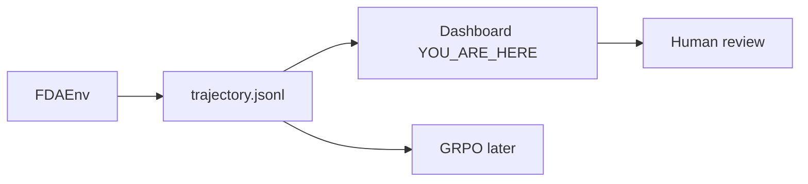

# 06 · Dashboard: the replay is the product

**Track:** web · **Branch:** `codex/audit-dashboard` · **Time:** 15 min

**By the end you can:**
- Point at the replay panel that would catch a memorized citation the leaderboard mean hides.
- Map `trajectory.schema.json` fields onto Overview and `/trajectories/[...id]`.
- Copy a `results/<run_id>.jsonl` dump into `web/public/results/` and say what still needs `tasks.json`.
- Explain why a malformed result row is skipped while a valid trajectory still appears.

---

## 2. Where this fits



GRPO only sees `reward.total`. If the dashboard shows a pretty mean and hides whether each quote appeared in *this* episode's tool output, you will ship a model that cites warfarin on a velmorastat question. Downstream of a wrong replay is a wrong paper screenshot, not a wrong training step.

---

## 3. Concepts

### 3.1 The leaderboard is a trap; the replay is the product

<details>
<summary><b>[predict]</b> The fixture run's mean reward is 0.48. If you only saw that number, would you guess the second episode was a correct boxed-warning answer?</summary>

Yes, that is the trap. 0.48 is the mean of **1.00, 0.10, 0.35**. The 0.10 episode answers "Yes. Bleeding risk: warfarin can cause major or fatal bleeding." — it *reads* right. The leaderboard cannot tell you the cited `set_id` never appeared in that trajectory's tool output. The common wrong answer is "0.48 means the model is halfway decent on every task."
</details>

A mean is what GRPO maximizes and what a README screenshot will quote. Reward hacking is a *trajectory-shaped* bug: the quote is real, the id is real, the episode never retrieved it. The only screen that can show that is the replay: steps on the left, citations with ✓/✗ on the right.

The badge is rendered in [replay.tsx:255](../web/components/replay.tsx#L255):

```tsx
<span className={`cite-validity sm ${ok ? "ok" : "bad"}`}>
  {ok ? "✓ verified" : "✗ invalid"}
</span>
```

The badge is not decoration. It is the product. Section 5 hides it on purpose.

<details>
<summary><b>[recall]</b> Which of the four reward bars can be 1.00 while correctness is 0, and what total does that produce?</summary>

Citation. FG-9003 cites `step:1` / `meta.results.total` with quote `"412"` (valid) and answers **1284** (wrong). Format is also 1. Total is **0.35** = 0.25 + 0.10. Efficiency stays 0 while correctness is 0. The common mix-up is to add 0.60 because "it cited the right field."
</details>

### 3.2 The schema is the UI spec; the question is not in it

<details>
<summary><b>[predict]</b> Open schemas/trajectory.schema.json. Which field holds the natural-language question the replay header displays?</summary>

**None.** Required fields are `id`, `run_id`, `task_id`, `model`, `seed`, `snapshot_version`, `started_at`, `steps`, `final_answer`, `terminated_by`, `reward`, `usage`. The question lives on the task, so the dashboard reads a sidecar [tasks.json](../web/public/results/tasks.json) keyed by `task_id`. The common wrong guess is `steps[0].thought`.
</details>

The replay is a projection of one JSON object. If a panel has no field, we either omit it or join another file.

| Schema field | Panel |
|---|---|
| `steps[].tool`, `arguments`, `output` | Left timeline, collapsible JSON |
| `final_answer.answer`, `.citations` | Right "Final answer" + `[1][2][3]` |
| `reward.total` and the four components | Right bars; contribution = weight × component |
| `reward.notes` | Lines under the bars; also drive ✓/✗ via `valid:` / `invalid:` |
| `usage.*` | "N tool calls · T s · tokens" in the Steps header |
| `task_id` | Title only after joining `tasks.json` |

Weights are copied from [combine.py:8](../fdagym/rewards/combine.py#L8), not from the B1 PNG (that mock used citation +0.30 and a negative tool budget).

[format.ts:3](../web/lib/format.ts#L3) copies those weights:

```ts
export const WEIGHTS = {
  correctness: 0.6,
  citation: 0.25,
  format: 0.1,
  efficiency: 0.05,
} as const;
```

<details>
<summary><b>[transfer]</b> FDAEnv writes id "baseline-2026-10-16/FG-0003/s0". The replay route is /trajectories/[...id]. What is params.id, and what string does getTrajectory see?</summary>

`params.id` is `["baseline-2026-10-16", "FG-0003", "s0"]`. [joinTrajectoryId](../web/lib/results.ts) joins on `/`, so lookup is `baseline-2026-10-16/FG-0003/s0`. Do not `encodeURIComponent` the slashes — that would look for a different id. Fixture ids still work: `["tr-fx-9001-s0"].join("/")` is itself. The common wrong answer is that a single `[id]` segment 404s (that was true before the catch-all).
</details>

### 3.3 The dashboard is a folder, not a server

<details>
<summary><b>[predict]</b> After evals write results/run-014.jsonl, what do you copy, and do you restart Next?</summary>

Copy `results/run-014.jsonl` and `results/run-014/summary.json` into `web/public/results/`. In `next dev`, refresh; [layout.tsx](../web/app/layout.tsx) sets `dynamic = "force-dynamic"` and reads the folder per request. No backend, no rebuild. The common extra step people invent is "POST to /api/ingest."
</details>

[results.ts](../web/lib/results.ts) scans `*.jsonl` and `*/summary.json`. Overview uses `leaderboard.json` if present, otherwise derives rows from the jsonl.

```ts
let parsed: unknown;
try {
  parsed = JSON.parse(trimmed) as unknown;
} catch {
  reportInvalid(file, "invalid JSON", lineNo);
  continue;
}
```

<details>
<summary><b>[recall]</b> You copy only the jsonl, not tasks.json. What is missing on the replay, and what still works?</summary>

The question in the header falls back to "`FG-XXXX · question not in results/tasks.json`". The timeline, citations, reward bars, and keyboard still work — they are all on the trajectory. Task cards on Overview disappear or go stale because they come from `tasks.json`.
</details>

### 3.4 File data is untrusted at the dashboard boundary

<details>
<summary><b>[predict]</b> A valid first JSONL row is followed by a half-written second row. Does the page keep the first trajectory, or fail the entire catalog?</summary>

It keeps the valid row and logs the bad row's file and line. JSONL is read one line at a time, so one partial write should not hide completed records. The common wrong assumption is that a parse error should abort the whole catalog because the file is one artifact.
</details>

The dashboard reads local files that can be written while an eval is running. `readJson` turns parse failures into `null`; the JSONL scanner skips invalid lines and validates the nested `steps`, `reward`, `usage`, `model`, and answer fields before handing data to UI code.

[results.ts](../web/lib/results.ts) also validates cache data before reuse. If a cache is malformed, it is disposable: the dashboard rebuilds it from JSONL and writes the replacement through a unique temporary path plus rename.

```ts
try {
  parsed = JSON.parse(trimmed) as unknown;
} catch {
  reportInvalid(file, "invalid JSON", lineNo);
  continue;
}
if (!isTrajectory(parsed)) {
  reportInvalid(file, "row does not match the trajectory shape", lineNo);
  continue;
}
```

<details>
<summary><b>[recall]</b> Why check `steps` and `reward` inside `isTrajectory` instead of only checking that those keys exist?</summary>

The replay calls array methods on `steps`, and aggregation reads numeric fields inside `reward`. Presence alone accepts values like `steps: {}` or `reward: null`, which then crash later while rendering. Parse untrusted JSON once at the edge, then keep the UI code simple.
</details>

---

## 4. Experiments

### 4.1 The weighted sum is a file check, not a vibe

From repo root:

```bash
cd web && npm run check-fixture
```

<details>
<summary><b>[predict]</b> Three fixture totals. One looks like a perfect label answer, one cites a real warfarin sentence, one cites the FAERS count it just fetched. What three numbers print, and which row is the warfarin sentence?</summary>

**1.00, 0.10, 0.35.** The warfarin sentence is **tr-fx-9002-s0**, R=0.10. Output when we ran it:

```text
tr-fx-9001-s0	FG-9001	1.00	1.00	3/3	yes
tr-fx-9002-s0	FG-9002	0.10	0.10	0/1	yes
  invalid: 0cbce382-9c88-4f58-ae0f-532a841e8f95 boxed_warning id not in this trajectory | correctness gated: no valid citation
tr-fx-9003-s0	FG-9003	0.35	0.35	1/1	yes

3 trajectories, totals match 0.60/0.25/0.10/0.05
```

The common wrong guess is that the warfarin row scores ~0.70 (correctness + format) because the quote is true in the snapshot. The id never appeared in *this* episode, so citation is 0 and correctness is gated.
</details>

### 4.2 Read the answers next to the totals

```bash
python3 - <<'PY'
import json
from pathlib import Path
for line in Path("web/public/results/fixture-run.jsonl").read_text().splitlines():
    t = json.loads(line)
    cite = t["final_answer"]["citations"][0]
    print(t["id"], "R=", t["reward"]["total"], "answer=", t["final_answer"]["answer"])
    print("  cite id=", cite["id"])
PY
```

Run that from the repo root (`bio-rl-web`), not from `web/`.

<details>
<summary><b>[predict]</b> FG-9003's tool output total is 412. It answers 1284. Will the first cite id be a safetyreportid or step:1?</summary>

**`step:1`.** FAERS counts have no record id of their own, so the contract cites the tool call: `id: "step:<n>"`, field `meta.results.total`. The 1284 is leftover from FG-9001. The citation is valid and the answer is wrong, which is why R=0.35 rather than 0.10. Output:

```text
tr-fx-9001-s0  R= 1.0 answer= 1284 serious reports in 2025. Yes, boxed warning for hepatotoxicity.
  cite id= 7c1e9a42-0d5e-4b8a-9f21-c06e1a7db31f
tr-fx-9002-s0  R= 0.1 answer= Yes. Bleeding risk: warfarin can cause major or fatal bleeding.
  cite id= 0cbce382-9c88-4f58-ae0f-532a841e8f95
tr-fx-9003-s0  R= 0.35 answer= 1284
  cite id= step:1
```
</details>

### 4.3 A partial line should not take down the result catalog

In a separate terminal, start the Next server from `web/` with `npm run dev`. Then append an invalid final row to the fixture JSONL and request the home page:

```bash
printf '{"partial":' >> public/results/fixture-run.jsonl
curl -s -o /dev/null -w '%{http_code}\n' http://localhost:3000/
```

<details>
<summary><b>[predict]</b> What HTTP status should the page return, and what should the server log identify?</summary>

It should return **200** and log a structured warning naming `fixture-run.jsonl`, the appended line number, and `invalid JSON`. The three complete episodes remain available. Output we got:

```text
200
[dashboard] Ignoring invalid result data { file: 'fixture-run.jsonl', line: 4, reason: 'invalid JSON' }
GET / 200 in 1897ms
```

Restore the fixture with `git checkout -- web/public/results/fixture-run.jsonl` after the experiment; do not commit the sabotage.
</details>

---

## 5. Break it

In [replay.tsx:255](../web/components/replay.tsx#L255), delete the `<span className={\`cite-validity ...\`}>` element (the ✓ verified / ✗ invalid badge). Leave the quote text.

<details>
<summary><b>[predict]</b> Which test fails, and what does a reviewer miss on tr-fx-9002-s0?</summary>

**No test fails.** `npm run check-fixture` only checks JSON totals. `npm run lint` does not look at the DOM. That is a finding: the dashboard has no test that citation validity is visible. A reviewer of FG-9002 still sees a fluent "Yes. Bleeding risk…" answer, a real-looking `set_id`, and the quote from the warfarin label. They miss that the id was never retrieved in this episode. Open [http://localhost:3000/trajectories/tr-fx-9002-s0](http://localhost:3000/trajectories/tr-fx-9002-s0) after `npm run dev` and confirm the badge is gone. Revert with `git checkout -- web/components/replay.tsx`.
</details>

```bash
cd web && npm run check-fixture && npm run lint
```

Both stay green on purpose.

---

## 6. Decisions I made

**B1's +0.30 / −0.02 is not the scorer.** The PNG is the look. [AGENTS.md](../AGENTS.md) is the math: 0.60 / 0.25 / 0.10 / 0.05, all contributions non-negative. The mock's "tool budget −0.02" would disagree with `reward.total` in the jsonl.

<details>
<summary><b>[why]</b> If the PNG and the jsonl disagree on a bar, which one should the dashboard follow, and what happens if you follow the PNG?</summary>

Follow the jsonl. The dashboard is a viewer. If it redraws citation as 0.30, a 1.00 episode displays 1.05 and you will debug the env for a bug that is only in the UI. The common wrong answer is "match the design file, evals can change later."
</details>

**Read the folder every request, do not `output: 'export'`.** Dropping in a new jsonl during `next dev` should show up on refresh. A static export would need a rebuild, which is the opposite of a handoff.

<details>
<summary><b>[why]</b> Why is force-dynamic worth the extra server render vs baking leaderboard.json into the client bundle?</summary>

Evals will land as files, not as a deploy. Baking would make "copy into public/results/" a lie unless you also rebuild. The trade is a tiny Node read vs a broken handoff. If this ever ships as a CDN-only static site, generate the pages at build and say so in the README.
</details>

**Ship a fictional fixture rather than wait.** Three episodes, footer *Example data · fictional drugs, models and records*. Real drugs wait on the evals track. The empty training curve is the honest B1 panel we cannot fake.

<details>
<summary><b>[transfer]</b> Evals replace fixture-run.jsonl with 312 real test tasks and forget to flip leaderboard.example to false. What should the UI do?</summary>

Keep the caption until `example` is false on the leaderboard or every summary. A real run that still says "fictional" is embarrassing; a fictional run that does not say it is worse. The flag is on [leaderboard.json](../web/public/results/leaderboard.json).
</details>

---

## 7. Gotchas in the real data or tools

- **The question is not on the trajectory.** [trajectory.schema.json](../schemas/trajectory.schema.json) has no `question`. Without `tasks.json`, replay still works and the header is just the id. I joined a small catalog instead of changing the schema.
- **Env ids contain slashes.** FDAEnv writes `{run_id}/{task_id}/s{seed}`. The replay is a catch-all `[...id]` that joins segments with `/` before lookup. Fixture ids (`tr-fx-9001-s0`) stay one segment. Do not encode the slashes away.
- **`submit_answer` is not a tool call.** [efficiency.py:5](../fdagym/rewards/efficiency.py#L5) skips it. B1's header said "4 tool calls" for three tools plus submit. The replay counts 3 on FG-9001.
- **B1's dataset footer is a mock.** 1,240 tasks / snapshot 2026-09-30. The worktree has 96 tasks (76 train + 20 test) and snapshot `2026-10-15`. The sidebar uses 96 so it does not invent a corpus.
- **create-next-app wanted Geist.** B1 is Inter + JetBrains Mono. The tokens live in [globals.css](../web/app/globals.css) (`--acc: #F5A524`). No shadcn.

---

## 8. Checkpoint

Run:

```bash
python3 -c "import sys;sys.path.insert(0,'scripts');import quiz;from pathlib import Path;print(len(quiz.parse(Path('learn/06-dashboard.md'))))"
```

Then `python3 scripts/quiz.py learn/06-dashboard.md`.

Answer these in chat, not in the quiz:

1. FG-9002's quote is a real warfarin sentence. If a reviewer only reads the Final answer paragraph (no badge, no notes), what evidence is left that the episode is a hack?
2. Should `tasks.json` be the evals track's job, or should every trajectory grow a `question` field? What does that do to the schema contract?
3. When a trained checkpoint lands, which Overview cell should stop showing "—" first: reward lift, or gap to frontier — and what file has to exist?

Then stop. When you say you are done, I will read `learn/answers/06-dashboard.jsonl` and go through every `p` or `n`.

---

## 9. Read next

- [B1-trajectory.html](../docs/design/B1-trajectory.html): the markup the replay copies. Keyboard and autoplay are the part the PNG cannot show.
- [trajectory.schema.json](../schemas/trajectory.schema.json): every panel is a field; if you cannot find the field, the panel is a join or a lie.
- [03-env-rewards.md](03-env-rewards.md): why FG-9002 is 0.10 and FG-9003 is 0.35. The dashboard only renders that decision.
