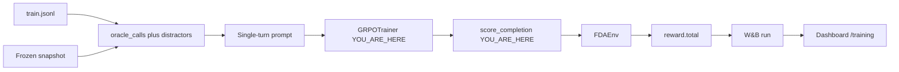

# 07 · Training: Plan A GRPO + LoRA

**Track:** train · **Branch:** `codex/audit-run-record` · **Time:** 15 min

**By the end you can:**
- Score a single-turn completion through `FDAEnv` and say why the oracle calls have to run *before* `submit_answer`.
- Compute GRPO advantages by hand and name the group that produces no gradient.
- Point at the LoRA rank and the stage-1 mix, and say which file a GPU job is not allowed to start from.

---

## 2. Where this fits



If `score_completion` skips the oracle tools, a perfect JSON answer still scores 0.10 and GRPO will treat "guess the format" as the only signal. If the curve dump is the wrong shape, `/training` stays empty forever.

---

## 3. Concepts

### 3.1 The model does not call tools. The env still does.

<details>
<summary><b>[predict]</b> Plan A puts retrieved documents in the prompt and the model only writes JSON. Why does training still call <code>search_drug_label</code> inside FDAEnv?</summary>

Because a citation is valid only when its `id` appeared in a tool output of *this* trajectory. If the documents live only in the prompt, the quote can be right and the id still "did not appear in this trajectory". The env has to play `oracle_calls` first, then `submit_answer`. Distractors stay in the prompt so they do not become valid ids and do not burn efficiency.
</details>

The loop is [score.py:31](../fdagym/train/score.py#L31):

```python
play_oracle(env, task)
parsed = parse_answer(completion)
arguments = parsed if parsed is not None else {}
_obs, _total, _done, info = env.step({"tool": "submit_answer", "arguments": arguments})
```

`play_oracle` is [context.py:11](../fdagym/train/context.py#L11). The prompt the *model* sees is assembled separately in [prompt.py](../fdagym/train/prompt.py) and never labeled "oracle" vs "distractor".

<details>
<summary><b>[recall]</b> A distractor FAERS document is packed into the prompt and the model cites its <code>id</code>. What should citation and correctness be?</summary>

Citation 0, correctness 0. That `id` was produced in a throwaway env. The scoring episode never ran that tool, so the id is not in `env.steps`. `test_distractor_id_is_not_a_valid_citation` locks it.
</details>

### 3.2 GRPO only learns when siblings disagree

<details>
<summary><b>[predict]</b> Eight completions of the same prompt all score 0.10 (valid JSON, no citation). What is the advantage of each, and how much does LoRA move?</summary>

Every advantage is 0, so the adapter does not move. Advantage is `(R_i − mean) / std` inside the group of 8. Equal rewards, including all-zeros and all-perfect, have std 0. The copy we test is [advantage.py:4](../fdagym/train/advantage.py#L4); TRL does the same inside `GRPOTrainer`.
</details>

```python
if std < eps:
    return [0.0] * n
return [(value - mean) / std for value in rewards]
```

That is why stage 1 wants tasks the model *sometimes* gets right, and why `base_pass_rate == 0` or `== 1` is dropped once those rates exist. Today they are still `null`, so the curriculum uses the structural mix only.

<details>
<summary><b>[transfer]</b> Rewards in a group of 4 are 1.0, 0.1, 0.1, 0.1. Who gets a positive advantage, and about how large?</summary>

Only the 1.0. Mean is 0.325, population std is about 0.390, so the winner is about **+1.73** and each 0.1 is about **−0.58**. You will see those numbers in the dry-run. The common wrong answer is "the three 0.1s get a small positive for being close to each other".
</details>

### 3.3 LoRA is the only thing we train, and torch is optional

<details>
<summary><b>[predict]</b> Qwen2.5-1.5B-Instruct has about 1.5 billion weights. What does LoRA r=16, α=32 actually update?</summary>

Small adapter matrices next to the frozen linear layers (`q_proj`, `k_proj`, `v_proj`, `o_proj`, `gate_proj`, `up_proj`, `down_proj`). Rank 16, α 32, dropout 0.05. The base weights stay put. Defaults live in [config.py:7](../fdagym/train/config.py#L7). Torch, TRL, and peft are an extra: `uv sync --extra train`. Tests never import them.
</details>

The GPU script is [scripts/grpo_singleturn.py](../scripts/grpo_singleturn.py). It wires `GRPOTrainer` + `LoraConfig` + `fda_reward`, which calls `score_completion` on each sibling. `--dry-run` never touches torch.

<details>
<summary><b>[why]</b> Why is the default 3B on Modal, not the 1.5B that PLAN.md named for a free T4?</summary>

JP's plan is Qwen2.5-3B-Instruct on Modal L40S (fits the $30/mo credit), then 7B on a RunPod A100 80GB only if the 3B adapter beats its own Plan A TEST baseline. Do not start Modal or RunPod from the training script. Commands live in [docs/train.md](../docs/train.md).
</details>

### 3.4 Stage 1 is a mix target, not a promise of easy tasks

<details>
<summary><b>[predict]</b> Stage 1 wants 60% easy / 30% medium / 10% hard. The fixture pool for dry-run is warfarin (medium), metformin top-reaction (medium), metformin count (hard). What mix do you actually get?</summary>

**0 easy, 2 medium, 1 hard.** There is no easy train task in the fixture. Shortages fill from the next harder tier ([curriculum.py:5](../fdagym/train/curriculum.py#L5), [docs/difficulty.md](../docs/difficulty.md)). `label_open` and the test split are dropped first.
</details>

```python
STAGE_MIX = {
    1: {"easy": 0.6, "medium": 0.3, "hard": 0.1},
    2: {"easy": 0.3, "medium": 0.5, "hard": 0.2},
    3: {"easy": 0.2, "medium": 0.4, "hard": 0.4},
}
```

The 150-drug train sheet has easy templates so this fill is rare in a real run. Until `base_pass_rate` is measured, stage 1 does not drop 0/8 or 8/8 tasks because every rate is `null`.

<details>
<summary><b>[recall]</b> After calibration, a task at pass rate 1.0 is dropped from training. What is it kept for?</summary>

A regression check: the trained model should still solve it. Stage 3 keeps the old 0/8 tasks ("dead today") because they may have become learnable.
</details>

---

## 4. Experiments

### 4.1 The train package has no torch

```bash
uv run pytest -q tests/train
```

<details>
<summary><b>[predict]</b> How many tests, and does pytest try to import TRL?</summary>

**46 passed** (this run: `46 passed in 24.94s`). Score, parse, curriculum, advantage, eval_local, checkpoint resume, and the prompt-coverage check over the frozen snapshot. No TRL, no GPU, no Modal client. If torch leaked into `fdagym/train/__init__.py`, this command would fail on a machine without the extra.
</details>

### 4.2 Gold is 1.0, junk is 0, format-only is 0.10

```bash
uv run python scripts/grpo_singleturn.py --dry-run
```

<details>
<summary><b>[predict]</b> What are gold / junk / format-only totals on FG-0001, and what is the stage-1 mix?</summary>

From this run:

```text
stage 1 n_prompts=3 mix={'easy': 0, 'medium': 2, 'hard': 1}
gold FG-0001 total=1.0000 correctness=1.0000 citation=1.0000 format=1.0000 efficiency=1.0000
junk FG-0001 total=0.0000
format-only FG-0001 total=0.1000 (NOT_FOUND, no citations)
advantages equal=[0.0 0.0 0.0 0.0]
advantages mixed=[1.732 -0.577 -0.577 -0.577]
```

Efficiency is 1.0 because the oracle used exactly `min_tool_calls` (2). If distractors had been extra `env.step`s, efficiency would drop below 1 even for a perfect submit. Format-only is 0.10: valid JSON, no citation, correctness gated.
</details>

### 4.3 One active writer owns a run id

```bash
uv run pytest -q tests/train/test_run_record.py::test_active_run_rejects_a_second_process_until_finish_releases_lock
```

<details>
<summary><b>[predict]</b> If two GPU jobs start with the same <code>run_id</code> at once, should they both append attempts and share checkpoints?</summary>

No. The first process takes an OS file lock in [run_record.py](../fdagym/train/run_record.py); the second receives `RunConflictError` before it can mutate the record or artifacts. `finish_run` releases the lock, and process exit releases it after a crash. This run printed `1 passed`; it starts a second Python process while the first holds the lease, then verifies that a later resume appends after the first attempt. The record uses a unique temporary file and atomic replace too.
</details>

---

## 5. Break it

In [score.py:31](../fdagym/train/score.py#L31), replace `play_oracle(env, task)` with `env.reset(task["id"])`. Leave `submit_answer` alone.

<details>
<summary><b>[predict]</b> Which test fails, and what total does the gold warfarin JSON get?</summary>

`test_gold_completion_scores_one` fails. Obtained total **0.1**, expected 1.0. The JSON still matches the schema (format 1.0). The set_id never appeared in this episode, so citation is 0 and correctness is gated. A python probe of the same sabotage said: `invalid: 0cbce382-9c88-4f58-ae0f-532a841e8f95 boxed_warning id did not appear in this trajectory`.
</details>

```bash
uv run pytest -q tests/train/test_score.py::test_gold_completion_scores_one --tb=line
```

The failure line from that run:

```text
FAILED tests/train/test_score.py::test_gold_completion_scores_one - assert 0.1 == 1.0
```

Revert with `git checkout -- fdagym/train/score.py`.

---

## 6. Decisions I made

**Plan A, not multi-turn GRPO.** The model writes JSON over prefetched docs. Multi-turn tool RL is TRL-experimental and would mix tool-choice errors into the same advantage. Evals stay multi-turn; training teaches grounded answering + citation. [PLAN.md §7](../docs/PLAN.md).

<details>
<summary><b>[why]</b> If Plan A raises train reward but test tool-calls stay at 6, what did we actually teach?</summary>

Reading and citing documents, not searching. Test evals still require the agent to call tools. A high Plan A curve with a flat multi-turn test is the failure mode to watch on the dashboard. The before/after that matters is the *test* split, with drugs never seen in training.
</details>

**Torch is an extra.** Default `uv sync` stays CPU-only so evals and the dashboard do not drag 2 GB of CUDA wheels. The trainer exits 2 with `uv sync --extra train` if you forget.

<details>
<summary><b>[transfer]</b> A CI job runs <code>pytest tests/train</code> on a laptop. Should it fail because TRL is missing?</summary>

No. Those tests must stay green without the extra. Only `scripts/grpo_singleturn.py` without `--dry-run` needs TRL.
</details>

**Distractors in the prompt, never in `env.steps`.** Putting them in the episode would make their ids citeable and would add tool calls, so a perfect submit would lose the 0.05 efficiency term.

<details>
<summary><b>[why]</b> Why shuffle oracle docs with distractors instead of always putting the real evidence first?</summary>

Position would leak. The model would learn "Document 1 is the answer" instead of reading. [dataset.py](../fdagym/train/dataset.py) shuffles. We also never print the word "oracle" in the prompt.
</details>

**One active writer per run id.** A metadata lock alone would not protect checkpoints or markers, so `start_run` holds the lock for the complete job and rejects a concurrent same-id launch. OS-managed locks disappear when a crashed process exits; a later retry can resume the recorded attempt history.

<details>
<summary><b>[why]</b> Why reject a concurrent launch instead of letting both jobs append their attempt under a short lock?</summary>

Because the run directory also contains checkpoints and completion markers. Serializing only the JSON update would still let both trainers overwrite those shared artifacts. The full-job lease makes run-id ownership explicit; use another id for an independent launch.
</details>

---

## 7. Gotchas in the real data or tools

- **Fixture stage 1 has zero easy tasks.** Dry-run mix was `easy: 0, medium: 2, hard: 1`. The fill rule is doing its job. The 150-drug sheet is what a GPU run should load (`--use-snapshot`), not `JsonSnapshot`.
- **`base_pass_rate` is still null** on every task. Curriculum cannot yet drop 0/8 or 8/8. Measure it with 8 samples of the *same* Qwen you will train, then write the rates onto the train split.
- **Efficiency is 1.0 for a perfect Plan A submit** only because `oracle_calls` length equals `min_tool_calls`. Extra env steps would silently tax every group.
- **Clipping uses the question, then keeps original order.** `_clip` in [context.py](../fdagym/train/context.py) keeps whole `results` records inside `max_pack_chars` (6000). Rank only decides which records survive a cut: application numbers and ids written in the question, plus generic or brand names that actually appear in the question. `submission_type == ORIG` is only a tie-break. Survivors stay in their original order. Gold fields are not read. On the frozen snapshot, checkable gold-in-prompt is 898/1054 train and 259/299 test (the blind prefix was 681/1054 and 183/299). Citation ids in the prompt are 686/720 train and 184/193 test. Decoys are still packed.
- **`max_prompt_length` is 8192.** TRL 0.21 would keep the *last* tokens past that, which drops the question. [launch.py](../fdagym/train/launch.py) refuses to start if a training prompt's chars/3 estimate exceeds the limit. [fit_context](../fdagym/train/prompt_len.py) sets `vllm_max_model_len` from the longest prompt in the stage pool plus the 256-token completion, rounded up to the next power of two and capped at 8192. It does not use a 4-document × 6000-character estimate. Stage 1 measures 6390 tokens (1160 prompts) and resolves to 8192. Two skipped `label_open` rows would not: FG-1553 estimates 9959 and FG-1556 estimates 8285, and launch would refuse them.
- **Dense reward is on for GRPO only.** Weights stay `0.60*correctness + 0.25*citation + 0.10*format + 0.05*efficiency`. Format is still 0.10, so a schema-only answer cannot outscore a partial citation (`0.25 * 0.50 = 0.125`). Id-only citations score 0.50 of the citation component. Near-miss correctness, only when the strict score is 0: punctuation 0.85, year taken from a date 0.70, brand/generic synonym 0.60, counts inside 10% relative 0.50 times the remaining band. Years do not get that 10% band. Case and whitespace stay at 1.0, which is what the strict scorer already did. `trajectory.reward` in eval jsonl stays strict, so it still compares to the 0.0185 baseline. `summary.json` adds `dense_reward`. On 1160 rendered train prompts, every group of 6 weak completions was tied under the strict score and none were tied under the dense score (base-like mean 0.0857 vs 0.294; gold mean 1.0 either way).
- **SFT warm-up copies gold that is already in the prompt.** [sft.py](../fdagym/train/sft.py) keeps 984 of 1229 train tasks (skipped 235 whose answer text is not in the user message, 8 whose citation is not, 2 over 8192 tokens). One epoch, LoRA, adapter `/vol/runs/sft-plan-a-qwen3b/adapter`. GRPO `--init-adapter` continues that adapter. No GPU was run from this checkout.
- **The curve file is retired.** Training now logs to Weights & Biases (see [10-wandb.md](10-wandb.md)). Overview and `/training` still plot a `training-curve.jsonl` if you drop one in `web/public/results/`; a missing file keeps `no training run yet`.
- **Paid TEST Qwen 7B pass rate was 12%.** That is the OpenRouter 7B in the *multi-turn* loop. The GRPO starting point is `scripts/eval_local.py` on the same HF checkpoint (Plan A, packed docs). Do not mix those two numbers.
- **Tool GRPO sampling default is T=0.65, not 0.8.** A pass@8 probe of the distill adapter at 0.8 had a **69%** unparseable-turn rate (mostly an opening `<tool_call>` that never closed; `FDAEnv` then reports `invalid JSON: Expecting value`). The same adapter under greedy hard eval was **10%** format errors. Probe and `train-tools` share `--temperature`.
- **Composite is not in the GRPO pool.** `--pool-types` is an allowlist (`boxed_warning,faers_top_reaction,approval,faers_count`). Hard-mix stays 600 rows at 60/40; the current slice refills from those types and still floors `boxed_warning`. Composite was 95% all-fail at pass@8 and is not on the hard eval.

<details>
<summary><b>[why]</b> Why not raise the 256 max-new-tokens cap to fix those unparseable <code>submit_answer</code> turns?</summary>

Typical gold submits are far under the cap: median train payload ~57 estimated tokens with short quotes, median hard_train ~103. The env error `Expecting value` is what you get when the raw turn starts with `<tool_call>` (the codec only extracts a body between matching tags). Greedy already finishes most turns inside 256. Sampling at 0.8 is what broke the format, so the next run lowers temperature instead of raising the cap.
</details>

---

## 8. Checkpoint

Run:

```bash
python3 scripts/quiz.py learn/07-training.md
```

Then answer these in chat, not in the quiz:

1. After a GPU run, train mean reward goes 0.25 → 0.70 and test tool-calls go 5.8 → 1.1. What did Plan A likely teach, and which dashboard page shows it?
2. A group of 8 on an unanswerable task: 7 valid `NOT_FOUND` with a grounded empty citation (R ≈ 1.0) and one `NOT_FOUND` with no citation (R = 0.10). Who gets the negative advantage, and should we keep that task in stage 1?
3. `base_pass_rate` for FG-0001 is measured at 8/8 on Qwen2.5-1.5B. Do we train on it in stage 1? What do we do with it instead?

Then stop. When you say you are done, I will read `learn/answers/07-training.jsonl` and go through every `p` or `n`.

---

## 9. Read next

- [TRL GRPO Trainer](https://huggingface.co/docs/trl/en/grpo_trainer): reward functions and `num_generations`, 10 min. Our `fda_reward` is one of those callables.
- [difficulty.md](../docs/difficulty.md): the mix table this curriculum implements, and why pass rate beats structural tier once it exists.
- [03-env-rewards.md](03-env-rewards.md): the gates `score_completion` is chasing. If those weights change, GRPO will chase the new ones.
