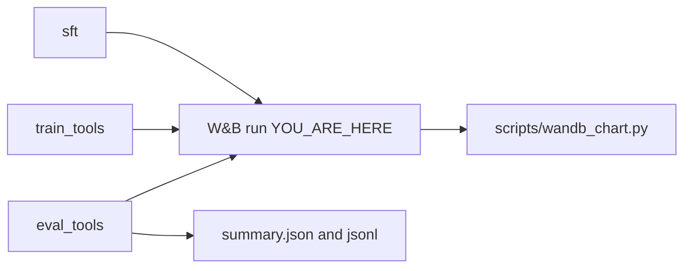

# 10 · Weights & Biases

**Track:** train · **Branch:** `cursor/wandb-run-metrics-9795` · **Time:** 15 min

**By the end you can:**
- Say which env var turns logging on, and what the run does when it is missing.
- Compute the step a checkpoint restart must not log again.
- Point at the Modal secret name and the chart command.

---

## 2. Where this fits



SFT, tool GRPO, and tool eval open one W&B run named with the job's `run_id`. The eval tarball (`summary.json`, `leaderboard.json`, `tasks.json`, the JSONL) is still what gets delivered. If the run id or the resume rule is wrong, a restarted job draws a second curve from step 0 on top of the first.

---

## 3. Concepts

### 3.1 No key, no crash

<details>
<summary><b>[predict]</b> CI has no WANDB_API_KEY. Does train_tools raise, or does it train with report_to empty?</summary>

It trains. `start_wandb` returns `enabled False` and `report_to []` before it imports wandb. TRL never installs the W&B callback. The same path catches an init error and an import error.
</details>

The check is one strip of the environment variable. The key is not a function argument.

```332:345:fdagym/train/wandb_log.py
    if not wandb_key_present():
        return disabled
    try:
        import wandb
    except ImportError:
        print("wandb is not installed; continuing with W&B disabled", flush=True)
        return disabled
    safe_config = scrub_config(dict(config))
    init_kwargs = {
        "project": chosen_project,
        "id": run_id,
        "name": run_id,
        "resume": "allow",
        "config": safe_config,
    }
```

<details>
<summary><b>[recall]</b> What is the project name when neither the flag nor WANDB_PROJECT is set?</summary>

`bio-rl`. `resolve_wandb_target` uses the flag, then the env var, then that default. Entity stays unset so the key's account default is used.
</details>

### 3.2 One run, no repeated steps

<details>
<summary><b>[predict]</b> A job dies at step 80. The last checkpoint is 50, and W&B already has step 73. On resume, which steps are logged again?</summary>

None at or below 73. `resume='allow'` reopens the same id. The floor is the max of the stored `train/global_step` and the checkpoint step. The trainer still recomputes from the checkpoint; those logs are dropped.
</details>

```55:66:fdagym/train/wandb_log.py
def resume_floor(*, resumed: bool, summary_step: int | None, resume_step: int | None) -> int | None:
    """Last step already stored on a resumed run. Logs at or below it are dropped.

    A new run (``resumed`` false) logs from the trainer's first step, even when a
    checkpoint exists in a project that has never seen this id.
    """
    if not resumed:
        return None
    steps = [step for step in (summary_step, resume_step) if step is not None]
    if not steps:
        return None
    return max(steps)
```

TRL's own callback is what ships `reward`, `rewards/env/mean`, and the tool stats. The GRPO callback only adds memorization onto that same dict, then sets `report_to` from the session ([grpo_tools.py](../fdagym/train/grpo_tools.py#L559)).

<details>
<summary><b>[transfer]</b> A brand-new run id has a checkpoint-50 directory, and W&B has never seen the id. What is the floor?</summary>

`None`. `resumed` is false, so the first log is kept even though a checkpoint exists. The floor applies only when W&B already has that run.
</details>

---

## 4. Experiments

### 4.1 Floor and the disabled path

```bash
uv run python -c "
from fdagym.train.wandb_log import resume_floor, resolve_wandb_target, start_wandb
print('floor', resume_floor(resumed=True, summary_step=73, resume_step=50))
print('fresh', resume_floor(resumed=False, summary_step=73, resume_step=50))
print('target', resolve_wandb_target('', ''))
s = start_wandb('demo', {'run_id': 'demo'})
print('enabled', s.enabled, 'report_to', s.report_to, 'project', s.project)
"
```

<details>
<summary><b>[predict]</b> With no key in the environment, is enabled True or False, and what is report_to?</summary>

False, and `[]`. Project is `bio-rl`. Floor of a resumed run with summary 73 and checkpoint 50 is 73. A run W&B has not seen yet has floor `None`.

```
floor 73
fresh None
target ('bio-rl', None)
enabled False report_to [] project bio-rl
```
</details>

### 4.2 The tests that lock this

```bash
uv run pytest tests/train/test_wandb.py -q --tb=no
```

<details>
<summary><b>[recall]</b> How many tests are in that file, and do they call the W&B API?</summary>

18 passed in 0.51s. They insert a fake `wandb` module. Nothing in that file talks to wandb.ai.
</details>

---

## 5. Break it

In [wandb_log.py](../fdagym/train/wandb_log.py#L66), change `return max(steps)` to `return min(steps)`.

<details>
<summary><b>[predict]</b> Which tests fail, and what floor do they see?</summary>

`test_resume_floor_and_checkpoint_step` and `test_resume_skips_steps_already_logged`. Both see floor 50 instead of 73, so steps 51–73 would be logged a second time.

```
E   assert 50 == 73
     +  where 50 = resume_floor(resumed=True, summary_step=73, resume_step=50)
2 failed in 0.07s
```

Revert with `git checkout -- fdagym/train/wandb_log.py`.
</details>

---

## 6. Decisions I made

**Same id, `resume='allow'`, drop steps at or below the floor.** A new random id on every orchestrator restart was the duplicate chart. The other option was to let W&B append and accept two points per step.

<details>
<summary><b>[why]</b> Why is the floor the max of the W&B step and the checkpoint step, not just the checkpoint step?</summary>

Logs can run ahead of the last save. A checkpoint at 50 with history through 73 must not draw 51–73 again. Using only the checkpoint would.
</details>

**TRL `report_to=wandb` for the trainer metrics. A small flatten for memorization and eval.** Copying those trainer keys into a JSONL was a second log of the same numbers.

<details>
<summary><b>[why]</b> Why keep summary.json when W&B already has eval/strict?</summary>

Results are delivered as tarballs in that format. The chart is for the person watching the run. The tarball is the artifact.
</details>

**The key is the Modal secret `wandb`.** It is not an argument and it is not printed. A missing key disables logging.

<details>
<summary><b>[transfer]</b> You want a different entity for one dry run. Do you edit modal_train.py?</summary>

No. Pass `--wandb-entity` or export `WANDB_ENTITY` before `scripts/launch_pipeline.py`. The secret can also carry `WANDB_ENTITY`. The project default stays `bio-rl`.
</details>

---

## 7. Gotchas

Hugging Face rewrites `reward` to `train/reward` and `rewards/env/mean` to `train/rewards/env/mean` before `wandb.log`. The chart looks up both names ([wandb_chart.py](../fdagym/train/wandb_chart.py#L109)).

The image ignores `.git`, so the container cannot run `git rev-parse`. Deploy bakes `FDAGYM_GIT_SHA` ([modal_train.py](../modal_train.py#L110)). That value is the config field `git_sha`.

A W&B exception is caught and the step continues. The message prints the exception type only, because some wandb errors echo the request.

The dashboard still reads `training-curve.jsonl` if you drop one in `web/public/results/`. Training does not write that file anymore.

---

## 8. Checkpoint

```bash
python scripts/quiz.py learn/10-wandb.md
```

Answer these in chat, not in the quiz:

1. A restart has checkpoint-100 and W&B history through step 140. Which steps get a new point, and which run id is used?
2. Where does `eval/type/boxed_warning/strict` come from, and which file on disk did we refuse to change to add it?
3. Why is `WANDB_API_KEY` absent from `start_wandb`'s signature?

Then stop. When you are done, the lesson's author reads `learn/answers/10-wandb.jsonl`.

---

## 9. Read next

- [docs/RUNBOOK.md](../docs/RUNBOOK.md) — the `modal secret create wandb` command and where the run shows up.
- [learn/09-hard-train.md](09-hard-train.md) — the memorization report this callback flattens onto the same step.
- [learn/07-training.md](07-training.md) — the old curve file, and why the test split is still the number that matters.
